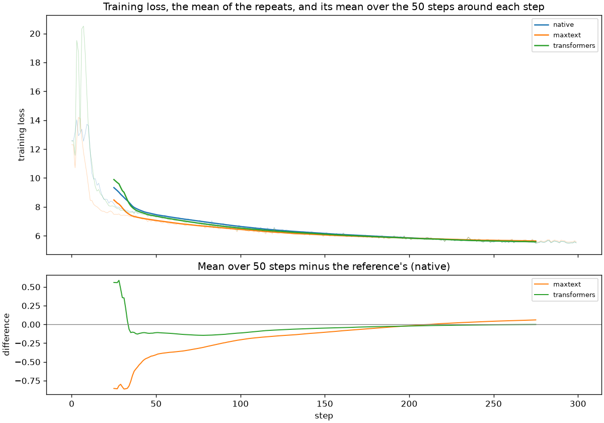
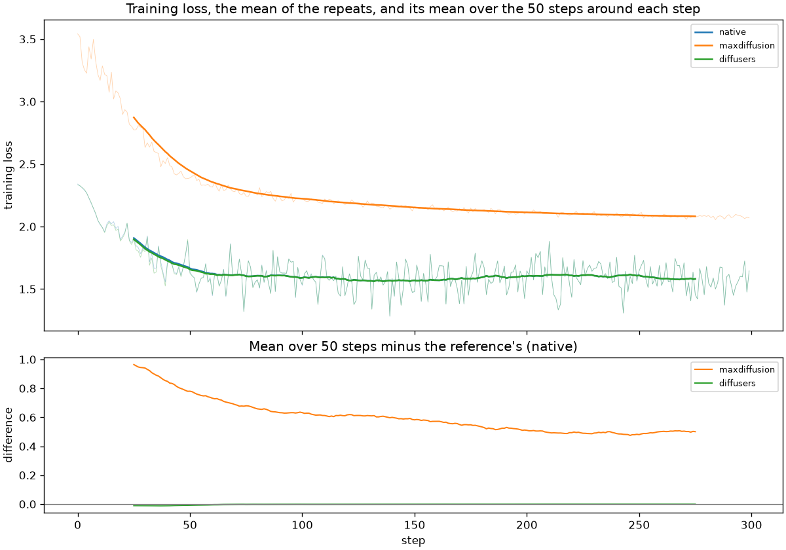

# Comparing an adapter with JAX-Titan's own model

An adapter trains another repository's network with JAX-Titan's trainer.
Where JAX-Titan has its own model of the same network, the two can be trained
alike, with only `--model` changed, so that what differs is the network's
implementation and its operators.
`python -m jax_titan.observability.compare` reads the records of such runs and
sets each against a reference: the loss, the validation loss and the speed. It
reads the runs of any model the trainer trains.

## Running a comparison

A comparison is two steps: the training runs, and then the tool on what they
recorded.

1. **Train each model** with the same arguments, `--seed` among them, so that
   every run takes the same batches. Change only `--model`, with the
   `--model_overrides` that make the networks the same, and give each run its
   own `--run_dir`.
2. **Compare the runs**, the reference first.

```bash
python -m jax_titan.trainer.train --model=llama3.1-8b $ARGS --run_dir=runs/native
python -m jax_titan.trainer.train --model=maxtext:llama3.1-8b $ARGS --run_dir=runs/adapter
python -m jax_titan.observability.compare runs/native runs/adapter
```

For the speed, run each model three times, in turns, so that a slow spell of
the node falls on all of them, and give the tool every run. The tool reads the
runs' records alone: it needs no GPU and trains nothing, so the same runs can
be compared again with other options.

| Option | What it does |
|---|---|
| `--window=N` | Steps per mean of the training loss, 50 by default |
| `--skip=N` | Warm-up steps of each run left out of its speed, 5 by default |
| `--names=A,B` | Names the configurations, in the order of their first run, instead of by their `--model` |
| `--figure=FILE` | Draws the loss curves (needs matplotlib, the `plots` extra) |
| `--json=FILE` | Writes every number |

## Reading the output

Runs whose arguments and GPU count are the same, but for where they write and
how they are watched, are repeats of one configuration. The tool prints, as
Markdown tables:

- **Configuration**: the arguments in which the configurations differ besides
  `--model`, when there are any.
- **Training loss**: the mean over each window of steps, with each
  configuration's difference to the reference, and how much the repeats of a
  configuration differ, for scale.
- **Validation loss**: after every validation pass (`--eval_every`), on the
  same held-out batches for every configuration, with the repeats' spread
  too.
- **Speed**: tokens/s per GPU, the median over each run's steady steps and
  over the repeats, their spread, the ratio to the reference, and the highest
  peak HBM per GPU of a run, as a range where that run's GPUs differ.

A run counts in a window only with every step of it, and the tool names the
runs that end before the reference. The figure draws each configuration's
loss, the mean of its repeats, with its mean over the window around each step
and the difference of that mean to the reference's.

The tool judges nothing. Models that start from other random weights part at
first, and the later windows tell whether they train alike. Two runs of one
configuration part as well, because a training run on GPUs is not bitwise
reproducible, so a difference no larger than the repeats' is no difference;
the same holds for the validation loss. The spread of tokens/s per GPU over
the repeats is the precision of the speed.

## Examples

### Llama 3.1 8B

JAX-Titan's Llama against MaxText's and transformers' Llama 3.1 8B, from
random weights on WikiText-103 in Llama 3's tokens, with FSDP over 8x
MI350X: 32 sequences of 2,048 tokens a step, 300 steps of AdamW at the
trainer's defaults, validation every 50 steps on 4 held-out batches, and
three runs of each model in turns, with JAX-Titan's XLA flags for ROCm and the
compilation cache off, on 2026-11-21. `$MODELS/llama3.1-8b` is a directory
with Llama 3.1 8B's `config.json`, the only file the transformers adapter
reads from it here.

```bash
export XLA_FLAGS="$JAX_TITAN_ROCM_XLA_FLAGS" JAX_ENABLE_COMPILATION_CACHE=false
ARGS="--parallel=fsdp --microbatches=1 --microbatch_size=32 --seq_len=2048 --steps=300 --eval_every=50"
for r in 1 2 3; do
  python -m jax_titan.trainer.train --model=llama3.1-8b $ARGS --run_dir=runs/native_r$r
  python -m jax_titan.trainer.train --model=maxtext:llama3.1-8b $ARGS --run_dir=runs/maxtext_r$r
  python -m jax_titan.trainer.train --model=transformers:$MODELS/llama3.1-8b $ARGS \
    --run_dir=runs/transformers_r$r
done
python -m jax_titan.observability.compare runs/native_r{1,2,3} runs/maxtext_r{1,2,3} \
  runs/transformers_r{1,2,3} --names=native,maxtext,transformers --figure=llama.png
```

The comparison prints:

> Reference: `native`. The configurations also differ in `--num_stages`:

| Configuration | `--num_stages` |
|---|---|
| `native` (reference) | `2` |
| `maxtext` | `1` |
| `transformers` | `1` |

| Training loss, mean over steps | 0-49 | 50-99 | 100-149 | 150-199 | 200-249 | 250-299 |
|---|---|---|---|---|---|---|
| `native` (reference) | 9.3346 | 7.0255 | 6.3657 | 6.0030 | 5.7396 | 5.5883 |
| `maxtext` | 8.4809 (-0.8537) | 6.7063 (-0.3191) | 6.2172 (-0.1485) | 5.9443 (-0.0588) | 5.7569 (+0.0173) | 5.6482 (+0.0599) |
| `transformers` | 9.8937 (+0.5591) | 6.8813 (-0.1442) | 6.2954 (-0.0703) | 5.9701 (-0.0329) | 5.7277 (-0.0119) | 5.5877 (-0.0007) |
| Repeats differ by up to | 0.2723 | 0.1100 | 0.0656 | 0.0346 | 0.0420 | 0.0404 |

| Validation loss, after step | 50 | 100 | 150 | 200 | 250 | 300 |
|---|---|---|---|---|---|---|
| `native` (reference) | 7.3720 | 6.5990 | 6.1210 | 5.8422 | 5.6236 | 5.4877 |
| `maxtext` | 6.9816 (-0.3903) | 6.4027 (-0.1963) | 6.0057 (-0.1153) | 5.8272 (-0.0150) | 5.6631 (+0.0395) | 5.5623 (+0.0746) |
| `transformers` | 7.3049 (-0.0670) | 6.4931 (-0.1059) | 6.0676 (-0.0533) | 5.8229 (-0.0192) | 5.6191 (-0.0044) | 5.4913 (+0.0036) |
| Repeats differ by up to | 0.1123 | 0.0677 | 0.0545 | 0.0464 | 0.0472 | 0.0446 |

| Speed | GPUs | Runs | Tokens/s per GPU | Spread over runs | Ratio to reference | Peak HBM per GPU (GiB) |
|---|---|---|---|---|---|---|
| `native` (reference) | 8 | 3 | 8,432 | 0.2% | 1.000 | 26.3 |
| `maxtext` | 8 | 3 | 9,712 | 0.2% | 1.152 | 28.2 |
| `transformers` | 8 | 3 | 11,122 | 0.0% | 1.319 | 39.1 |

<p align="center">
  
</p>

- **The three start apart.** Each draws its random weights its own way: the
  first losses are 12.58, 12.30 and 12.56, and the adapters' means over the
  first 50 steps lie 0.85 below and 0.56 above the native model's.
- **transformers' Llama trains like JAX-Titan's.** From step 150 on its means
  are within 0.033 of the native model's, less than the repeats of one
  configuration differ there (0.035 to 0.042), and from step 200 on its
  validation losses are within 0.02, where the repeats differ by up to 0.047.
- **MaxText's Llama is below at first and above at the end:** by 0.060 over
  steps 250-299, where the repeats differ by 0.040, and by 0.075 in
  validation after step 300, where they differ by 0.045. The two give the
  same loss and gradients from the same weights
  ([maxtext.md](maxtext.md#jax-titans-own-llama-against-the-adapter)); here
  they start from different ones.
- **`--num_stages` is the native Llama's default, 2**, that of a pipeline
  model; under `--parallel=fsdp` its stages run as one program, and their
  number only decides how its random weights are drawn.
- **JAX-Titan's Llama is the slowest of the three:** transformers' Llama,
  traced through torchax, runs at 1.32 times its tokens/s per GPU and
  MaxText's at 1.15. They peak at 39.1 and 28.2 GiB per GPU, where JAX-Titan's
  Llama peaks at 26.3.

### FLUX.1-dev

JAX-Titan's FLUX.1-dev against MaxDiffusion's and diffusers' FLUX.1, from
random weights on the synthetic batches of the two FLUX.1 adapters, with FSDP
over 8x MI350X: 8 samples of 512 x 512 pixels a step, 1,024 image tokens and
512 text tokens each, 300 steps of AdamW with `--lr=1e-5`, validation every
50 steps on 4 held-out batches, and three runs of each model, with
JAX-Titan's XLA flags for ROCm and the compilation cache off, on 2026-11-21
and 22. [recipes/flux.md](../recipes/flux.md) describes JAX-Titan's FLUX.1
and compares it with diffusers' model from the same weights.

```bash
export XLA_FLAGS="$JAX_TITAN_ROCM_XLA_FLAGS" JAX_ENABLE_COMPILATION_CACHE=false
ARGS="--parallel=fsdp --microbatches=1 --microbatch_size=8 --resolution=512 --steps=300 --lr=1e-5 --eval_every=50"
for r in 1 2 3; do
  python -m jax_titan.trainer.train --model=flux-dev $ARGS --run_dir=runs/native_r$r
  python -m jax_titan.trainer.train --model=maxdiffusion:flux-dev $ARGS --run_dir=runs/maxdiffusion_r$r
  python -m jax_titan.trainer.train --model=diffusers:FluxTransformer2DModel \
    --model_overrides='{"guidance_embeds": true}' $ARGS --run_dir=runs/diffusers_r$r
done
python -m jax_titan.observability.compare runs/native_r{1,2,3} runs/maxdiffusion_r{1,2,3} \
  runs/diffusers_r{1,2,3} --names=native,maxdiffusion,diffusers --figure=flux.png
```

The comparison prints:

> Reference: `native`. The configurations also differ in `--model_overrides`:

| Configuration | `--model_overrides` |
|---|---|
| `native` (reference) | `""` |
| `maxdiffusion` | `""` |
| `diffusers` | `"{\"guidance_embeds\": true}"` |

| Training loss, mean over steps | 0-49 | 50-99 | 100-149 | 150-199 | 200-249 | 250-299 |
|---|---|---|---|---|---|---|
| `native` (reference) | 1.9086 | 1.6043 | 1.5702 | 1.5828 | 1.6115 | 1.5812 |
| `maxdiffusion` | 2.8732 (+0.9646) | 2.2840 (+0.6797) | 2.1830 (+0.6128) | 2.1310 (+0.5483) | 2.1014 (+0.4899) | 2.0821 (+0.5009) |
| `diffusers` | 1.8979 (-0.0107) | 1.6029 (-0.0014) | 1.5694 (-0.0008) | 1.5826 (-0.0002) | 1.6115 (+0.0000) | 1.5812 (-0.0000) |
| Repeats differ by up to | 0.0001 | 0.0001 | 0.0000 | 0.0000 | 0.0000 | 0.0000 |

| Validation loss, after step | 50 | 100 | 150 | 200 | 250 | 300 |
|---|---|---|---|---|---|---|
| `native` (reference) | 1.6654 | 1.6433 | 1.6363 | 1.6319 | 1.6296 | 1.6278 |
| `maxdiffusion` | 2.4247 (+0.7594) | 2.2453 (+0.6020) | 2.1670 (+0.5307) | 2.1257 (+0.4938) | 2.1007 (+0.4711) | 2.0876 (+0.4598) |
| `diffusers` | 1.6654 (+0.0001) | 1.6404 (-0.0029) | 1.6359 (-0.0004) | 1.6325 (+0.0006) | 1.6291 (-0.0004) | 1.6276 (-0.0002) |
| Repeats differ by up to | 0.0002 | 0.0001 | 0.0001 | 0.0000 | 0.0001 | 0.0000 |

| Speed | GPUs | Runs | Tokens/s per GPU | Spread over runs | Ratio to reference | Peak HBM per GPU (GiB) |
|---|---|---|---|---|---|---|
| `native` (reference) | 8 | 3 | 3,289 | 0.5% | 1.000 | 23.0 to 56.1 |
| `maxdiffusion` | 8 | 3 | 3,341 | 0.4% | 1.016 | 23.7 |
| `diffusers` | 8 | 3 | 3,137 | 0.5% | 0.954 | 38.4 |

<p align="center">
  
</p>

On these batches the loss has a floor: a sample noised at `s` cannot score
below `1 / ((1 - s)^2 + s^2)`, which averages 1.54 to 1.59 over the windows of
50 steps and is 1.6082 on the 4 validation batches. The floor needs only each
noised latent and its `s`: the text, the pooled features and the positions
carry nothing the target depends on. So the curves show how fast a model
learns that, which its initialization mostly decides, and not whether its
attention, rotary embedding or text stream are right; the comparison from
the same weights covers those.

- **JAX-Titan's FLUX.1 trains like diffusers'.** Their means part by 0.011
  over the first 50 steps, where their different random weights tell, by
  0.0014 over the next 50, and by 2e-4 or less from step 150, still a few
  times what the repeats differ: what is left of their different starts.
  Their validation losses are within 0.003, and within 6e-4 from step 150.
  Both end 0.02 above the floor.
- **MaxDiffusion's FLUX.1 ends 0.50 above them**, and 0.46 in validation.
  It draws the weights of its blocks with flax's `lecun_normal`, variance
  1/fan-in, and zero biases, where diffusers' model and JAX-Titan's take
  PyTorch's default, a third of that variance with random biases. It also
  keeps a RoPE base of 1,000, where the published model's is 10,000, and
  computes its timestep embedding in bf16
  ([maxdiffusion.md](maxdiffusion.md#known-issues)).
  Initialized MaxDiffusion's way instead, two runs of JAX-Titan's FLUX.1, made
  before its initialization became diffusers', stayed below MaxDiffusion's
  means of 50 steps by 0.0045 to 0.0091, and below its validation losses by
  0.048 after 50 steps and 0.012 after 300: the initialization makes nearly
  all of the gap.
- **The overrides give diffusers' model FLUX.1-dev's guidance embedding**,
  which `flux-dev` and `maxdiffusion:flux-dev` have by name.
- **The repeats differ by at most 2e-4**: these runs repeat themselves on the
  GPUs far more closely than the Llama runs above.
- **The three run at about the same speed**: MaxDiffusion's at 1.016 times
  JAX-Titan's tokens/s per GPU and diffusers' at 0.954. JAX-Titan's model
  peaks at 56.1 GiB on its first GPU, where its random weights are drawn
  before they are sharded, and at 23.0 GiB on the others.
