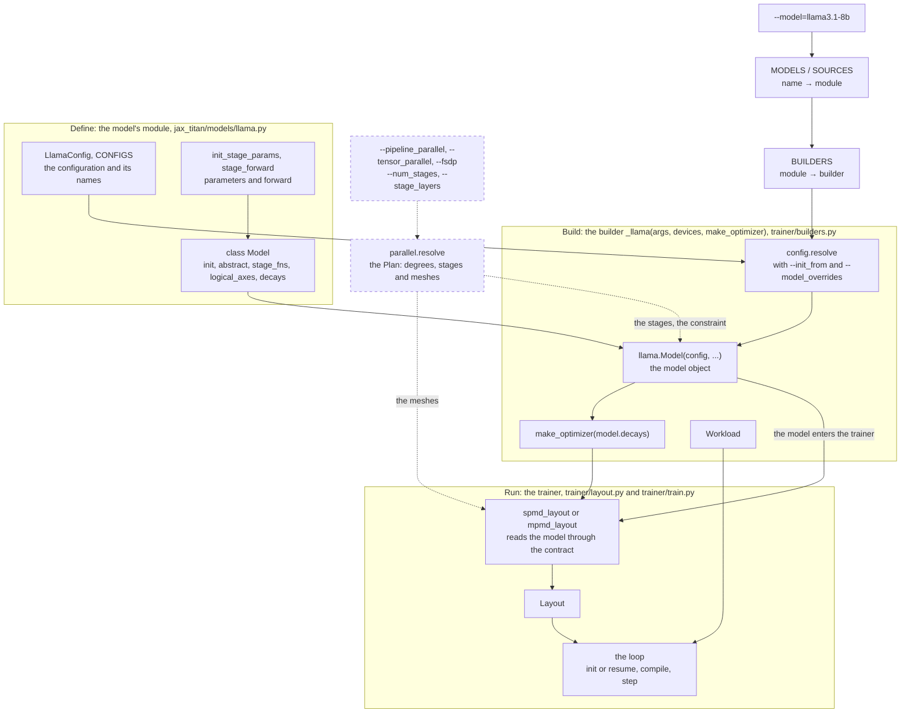

# Models and parallelism: design

The design of how a model is defined, how it gets into the trainer, and how a run is made
parallel.

- **Sections 1 and 2, models:** as the code implements them.
  [../adding_a_model.md](../adding_a_model.md) has the steps for a new model.
- **Sections 3 and 4, parallelism:** a proposal, which the code does not implement yet.
  `python -m jax_titan.trainer.train --help` has the flags of today, and
  [../pipelines.md](../pipelines.md) the schedules and the measurements.

## From a model's definition to the trainer

A model is defined in its module, found through two tables, built by its builder, and given to a
layout function of the trainer. The example is Llama; an adapter model goes the same way through
`SOURCES`. The dashed part is the proposal of section 3: the flags of parallelism come to a plan,
which the builder takes in place of `devices`; it gives the model its stages and the layout
function its meshes.



The tables are in 1.2 and 1.5, the builder in 1.2, the contract of `class Model` in 1.3, the
configuration in 1.4 and the plan in 3.3. What the trainer does with a `Layout` is as today.

## 1. Models

### 1.1 Design patterns

This change uses four patterns: a registry finds a factory function, the factory function makes a
model that meets an interface, and the model carries its configuration as a value object.

| Pattern | Where | In place of |
|---|---|---|
| **Registry** | `MODELS` and `SOURCES`: a name of `--model` to its module (1.5); `BUILDERS`: a module to its builder (1.2); `CONFIGS`: a name to its configuration (1.4) | the chain of `if`s of `build`, the tuples of names beside it, and a help of `--model` written by hand |
| **Factory function** | a builder: one function per JAX-Titan model and per adapter source, all of one signature, in `trainer/builders.py` (1.2) | builders of four signatures, called from the chain of `if`s |
| **Interface**, as a `Protocol` | the model contract, `models/contract.py` (1.3) | a docstring in the trainer |
| **Value object** | a frozen configuration on every model, `AdapterConfig` for an adapter model, recorded whole (1.4) | an adapter's configuration held in the flags alone, and a checkpoint that records the name of the model alone |

Left out on purpose:

- the builder pattern: a builder here is a plain function, called once;
- registration by decorator: the tables are written out;
- a base class for models: a class meets the contract by having its members;
- a wrapper object around a model, such as a facade;
- a YAML configuration system.

### 1.2 A model and its builder

**Patterns:** factory function, registry.

| | What it is | Code |
|---|---|---|
| **Model** | configuration, parameters, forward, the class the trainer uses | `jax_titan/models/<name>`, a module or a package |
| **Builder** | the factory function of a model: from the flags, what the trainer runs | `jax_titan/trainer/builders.py`: one function per JAX-Titan model and per adapter source, all in this one file |

Every builder has the same signature:

```python
def _llama(args, devices, make_optimizer) -> tuple[Layout, Workload]: ...
```

| | | What it is |
|---|---|---|
| in | `args` | every flag of the run |
| in | `devices` | the devices of the run, `jax.devices()` |
| in | `make_optimizer` | the trainer's function: `make_optimizer(decays)` gives the optimizer |
| out | `Layout` | how the training state is placed and stepped: `init`, `abstract_state`, `step`, `input_spec`, `target_spec`, `put_batch`, `structure`, `placement`, `eval_step`, `export`, `frozen` |
| out | `Workload` | what one step processes: `num_params`, `tokens_per_step`, `flops_per_step`, `hardware_flops_per_step`, `vocab_size`, `next_batch`, `data` |

`Layout` and `Workload` are the dataclasses of `trainer/layout.py`, as today but for one new field,
the model's `config` on `Layout` (1.4).

The model object is not returned. A builder makes the model and gives it to a layout function of
the trainer, `spmd_layout` or `mpmd_layout`, which reads it through the contract (1.3) and closes
it into the `Layout`. The trainer's loop holds a `Layout` and a `Workload`, and no model.

The table that finds a builder and the trainer's one entry are in the same file. The entry keeps
today's signature:

```python
# jax_titan/trainer/builders.py
BUILDERS = {                            # module of the model (1.5) -> its builder
    "llama": _llama,
    "flux": _flux,
    "ideogram": _ideogram,
    "command_a": _command_a,
    "adapters.maxtext": _maxtext,
    "adapters.maxdiffusion": _maxdiffusion,
    "adapters.transformers": _transformers,
    "adapters.diffusers": _diffusers,
}

def build(args, devices, make_optimizer) -> tuple[Layout, Workload]:
  ...                                   # the checks that name no model, as today
  return BUILDERS[models.module_of(args.model)](args, devices, make_optimizer)
```

Adding a model is its module, one builder, and its names in the table of names (1.5).

### 1.3 The model contract

**Pattern:** interface.

Today's contract, written as a type. Its members do not change.

```python
# jax_titan/models/contract.py
class Model(Protocol):
  config: Any                                    # a frozen dataclass

  def init(self, seed: int) -> tuple: ...        # the parameters of each stage
  def abstract(self, seed: int) -> tuple: ...    # their shapes and dtypes, without initializing
  def stage_fns(self) -> list[Callable]: ...     # one per stage; the last takes the targets, returns the loss
  def logical_axes(self, path, leaf) -> tuple | None: ...
  def decays(self, path, leaf) -> bool: ...      # whether a parameter takes weight decay
```

Optional, as today: `load(path)`, `place(path, targets)`, `merge(stage_params)`, and
`is_frozen(path)` with `dtype`.

The layout functions call a model through these members alone, and a class meets the contract by
having them, without a base class. An optional member is used when a model has it.

Two things are new:

- **`decays` on every model.** Each model names its own norms, and the trainer's list of every
  model's norm names goes.
- **`config` on every model.** The JAX-Titan models have it today; an adapter model gets an
  `AdapterConfig` (1.4), so that the configuration of every run can be recorded.

The loss stays in the last stage. The copies of one loss become one function in
`jax_titan/models/losses.py`, which the models call.

### 1.4 Configuration

**Patterns:** value object, registry.

- **A configuration is a frozen dataclass:** it cannot change once made, and an override gives a
  new one.
- **A JAX-Titan model** has its dataclass and `CONFIGS = {name: config}`, the names `--model`
  takes.
- **One entry for every JAX-Titan model:** `config.resolve(module, name, init_from, overrides)`.
- **`--model_overrides`** holds fields of the configuration only. `--dtype`, `--freeze`,
  `--image_tiles`, `--timestep_mean` and `--timestep_std` become flags.
- **An adapter model** has `AdapterConfig(source, name, overrides)`: a reference to the source's
  own configuration, which stays inside the adapter.
- **The configuration is recorded** in a checkpoint, and a resume with another one is refused. It
  reaches the trainer's loop as `Layout.config`, which a layout function takes from
  `model.config`.

### 1.5 Model names

**Pattern:** registry.

One table ties a name of `--model` to the module that implements it, and nothing else does.

```python
# jax_titan/models/__init__.py
MODELS = {                              # --model=<name> -> its module, imported on use
    "llama3.1-8b":    "llama",
    "llama3-test":    "llama",
    "flux-dev":       "flux",
    "flux-schnell":   "flux",
    "ideogram4":      "ideogram",
    "command-a-plus": "command_a",
}
SOURCES = {                             # --model=<source>:<name> -> the adapter's module
    "maxtext":      "adapters.maxtext",
    "maxdiffusion": "adapters.maxdiffusion",
    "transformers": "adapters.transformers",
    "diffusers":    "adapters.diffusers",
}
```

- **The trainer** has one builder per module of this table (`BUILDERS`, 1.2). Planning and the
  other tools look a name up in the same table.
- **A test** holds the table and the modules' `CONFIGS` together in both directions: a
  configuration that is not in the table fails, and so does a name without a configuration.
- **The help of `--model`** is made from the table.

### 1.6 Files and class names

```
jax_titan/
  models/
    __init__.py              MODELS, SOURCES: the names and the modules that implement them
    contract.py              the Protocol
    config.py                resolve, AdapterConfig
    losses.py                cross_entropy, masked_cross_entropy, mean_squared_error
    weights.py               safetensors and saved parameters (today's pretrained.py)
    llama.py  flux.py        a model is a module ...
    ideogram/  command_a/    ... or a package: model.py, weights.py, generate.py
    adapters/                maxtext.py  maxdiffusion.py  transformers.py  diffusers.py  torch_bridge.py
  trainer/
    train.py                 the loop
    builders.py              BUILDERS, build, the builders of JAX-Titan models and of adapters
    layout.py                Layout, Workload, spmd_layout, mpmd_layout: moved from adapters.py as they are
```

- A model becomes a package once it has more than its definition: published weights, generation.
- The class is `Model` in a JAX-Titan model's module (`llama.Model`) and `AdapterModel` in an
  adapter's (`mt.AdapterModel`), beside `AdapterConfig`. A configuration class is `<Name>Config`.

## 2. Models: examples

Each example is today's code with the changes of section 1; `...` stands for what is left out.

### 2.1 A JAX-Titan model: Llama

`LlamaConfig` is the value object, `CONFIGS` the registry of its names, `Model` the class that
meets the interface, and `_llama` its factory function.

```python
# jax_titan/models/llama.py
@dataclasses.dataclass(frozen=True)
class LlamaConfig:
  vocab_size: int
  emb_dim: int
  num_layers: int
  ...

CONFIGS = {
    "llama3.1-8b": LlamaConfig(vocab_size=128256, emb_dim=4096, num_layers=32, ...),
    "llama3-test": LlamaConfig(vocab_size=128256, emb_dim=256, num_layers=4, ...),
}

def init_stage_params(cfg, key, stage, num_stages) -> dict: ...   # fp32 parameters of one stage
def logical_axes(path, leaf): ...
def decays(path, leaf) -> bool:
  return path[-1].key not in ("attn_norm", "mlp_norm", "final_norm")
def stage_forward(params, inputs, targets, *, cfg, stage, num_stages, remat, constrain, compute_dtype):
  ...                                             # the last stage returns losses.cross_entropy(logits, targets)


class Model:
  logical_axes = staticmethod(logical_axes)
  decays = staticmethod(decays)

  def __init__(self, config, *, dtype=jnp.bfloat16, remat=True, constrain=None):
    self.config, self.dtype, self._remat, self._constrain = config, dtype, remat, constrain

  def init(self, seed=0):
    return (jax.jit(lambda key: init_stage_params(self.config, key, 0, 1))(jax.random.key(seed)),)

  def abstract(self, seed=0):
    return (jax.eval_shape(lambda: init_stage_params(self.config, jax.random.key(seed), 0, 1)),)

  def stage_fns(self):
    return [functools.partial(stage_forward, cfg=self.config, stage=0, num_stages=1, remat=self._remat,
                              constrain=self._constrain, compute_dtype=self.dtype)]
```

`init_stage_params` and `stage_forward` keep their stage arguments: Llama runs as one stage until
its pipeline returns.

```python
# jax_titan/trainer/builders.py
def _llama(args, devices, make_optimizer):
  _one_stage(args, ops=True)                      # Llama has no pipeline yet
  cfg = config.resolve(llama, args.model, overrides=_overrides(args))
  _needs_own_tokens(args, cfg.vocab_size)
  mesh = _data_mesh(devices)
  model = llama.Model(cfg, dtype=jnp.dtype(args.dtype), remat=args.remat,
                      constrain=_keep_batch_sharded(mesh))
  tokens, _ = _token_batches(args)                # the spec of a step's token windows
  layout = spmd_layout(args, mesh, model, make_optimizer(model.decays), tokens, tokens,
                       lambda batch: (batch[None, :, :-1], batch[None, :, 1:]))
  work = Workload(num_params=cfg.num_params(), tokens_per_step=..., flops_per_step=...,
                  vocab_size=cfg.vocab_size, hardware_flops_per_step=...)
  return layout, work
```

### 2.2 MaxText

MaxText's `Transformer` called whole. The model keeps MaxText's configuration inside.

```python
# jax_titan/models/adapters/maxtext.py
class AdapterModel:                               # today's WholeModel
  def __init__(self, config, cfg, mesh, *, attention=None, fsdp=False):
    self.config = config                          # the AdapterConfig
    self.cfg, self.mesh = cfg, mesh               # MaxText's own configuration and mesh
    ...

  def init(self, seed=0): ...                     # MaxText's initialization, as today
  def abstract(self, seed=0): ...
  def load(self, path): ...                       # a MaxText checkpoint, as today
  def stage_fns(self): ...                        # losses.cross_entropy plus MaxText's load-balance term
  def logical_axes(self, path, leaf): ...         # MaxText's own axis names
  def decays(self, path, leaf) -> bool: ...       # all but MaxText's norms
  def flops_per_token(self) -> float: ...
```

```python
# jax_titan/trainer/builders.py
def _maxtext(args, devices, make_optimizer):
  name = args.model.partition(":")[2]
  _one_stage(args, ops=True)
  overrides = {"remat_policy": "full", **_overrides(args), "max_target_length": args.seq_len}
  cfg = mt.config(name, **overrides)              # MaxText's own configuration
  _needs_own_tokens(args, cfg.vocab_size)
  mesh = mt.mesh(cfg, devices)                    # MaxText's own mesh
  model = mt.AdapterModel(AdapterConfig("maxtext", name, tuple(overrides.items())), cfg, mesh,
                          attention=_routed_attention(), fsdp=args.parallel == "fsdp")
  tokens, split_batch = _token_batches(args)
  layout = spmd_layout(args, mesh, model, make_optimizer(model.decays), tokens, tokens, split_batch)
  work = Workload(num_params=_num_params(model.abstract(args.seed)), tokens_per_step=...,
                  flops_per_step=..., vocab_size=cfg.vocab_size)
  return layout, work
```

### 2.3 MaxDiffusion

A MaxDiffusion denoiser called whole: FLUX.1 or Wan 2.1.

```python
# jax_titan/models/adapters/maxdiffusion.py
class AdapterModel:                               # today's WholeModel
  def __init__(self, config, init_full, apply, mesh, *, fsdp=False, stacked=()):
    self.config = config                          # the AdapterConfig
    ...

  def init(self, seed=0): ...                     # MaxDiffusion's initialization, as today
  def abstract(self, seed=0): ...
  def stage_fns(self): ...                        # losses.mean_squared_error of the denoiser's prediction
  def logical_axes(self, path, leaf): ...
  def decays(self, path, leaf) -> bool: ...       # all but MaxDiffusion's norms

def whole_flux(config, flux, mesh, *, fsdp=False, attention=None) -> AdapterModel: ...
def whole_wan(config, mesh, *, fsdp=False, **kwargs) -> AdapterModel: ...
```

```python
# jax_titan/trainer/builders.py
def _maxdiffusion(args, devices, make_optimizer):
  name = args.model.partition(":")[2]
  _one_stage(args, ops=name not in md.WAN)
  kwargs = {"dtype": jnp.bfloat16, "weights_dtype": jnp.float32,
            "remat_policy": "FULL" if args.remat else "NONE", **_overrides(args)}
  mesh, fsdp = _data_mesh(devices), args.parallel == "fsdp"
  flux = md.transformer(name, **kwargs)           # Wan 2.1 goes through whole_wan in the same way
  model = md.whole_flux(AdapterConfig("maxdiffusion", name, tuple(kwargs.items())), flux, mesh,
                        fsdp=fsdp, attention=_routed_attention())
  batches, text_tokens = _flux_batches(args, in_channels=flux.in_channels, ...)
  inputs, targets = _batch_specs(batches)
  layout = spmd_layout(args, mesh, model, make_optimizer(model.decays), inputs, targets,
                       lambda batch: batch)
  work = Workload(num_params=_num_params(model.abstract(args.seed)), tokens_per_step=...,
                  flops_per_step=..., next_batch=batches.next_batch)
  return layout, work
```

### 2.4 transformers

A PyTorch module traced through torchax. The module holds its own weights.

```python
# jax_titan/models/adapters/torch_bridge.py
class AdapterModel:                               # today's Bridged
  def __init__(self, config, module, *, dtype, loss):
    self.config, self.module, self.dtype = config, module, dtype
    ...

  def init(self, seed=0): ...                     # the module's own parameters, as today
  def abstract(self, seed=0): ...
  def load(self, path): ...
  def stage_fns(self): ...                        # loss(the module's forward, inputs, targets)
  def logical_axes(path, leaf): ...               # a staticmethod, as today
  def decays(self, path, leaf) -> bool: ...       # all but the scales and biases of norms, as today

# jax_titan/models/adapters/transformers.py
def causal_lm(config, cfg, *, seed, dtype, remat=True, init_from="") -> torch_bridge.AdapterModel:
  module = ...                                    # from_pretrained(init_from) or from_config(cfg)
  return torch_bridge.AdapterModel(config, module, dtype=dtype, loss=_loss)

def _loss(forward, tokens, targets):
  return losses.cross_entropy(forward({"input_ids": tokens}), targets)
```

```python
# jax_titan/trainer/builders.py
def _transformers(args, devices, make_optimizer):
  name, overrides = args.model.partition(":")[2], _overrides(args)
  _one_stage(args)
  cfg = hf.config(name, **overrides)              # refused unless its model type is verified
  vocab_size = hf.vocab_size(cfg)
  _needs_own_tokens(args, vocab_size)
  model = hf.causal_lm(AdapterConfig("transformers", name, tuple(overrides.items())), cfg,
                       seed=args.seed, dtype=jnp.dtype(args.dtype), remat=args.remat,
                       init_from=args.init_from)
  tokens, split_batch = _token_batches(args)
  layout = spmd_layout(args, _data_mesh(devices), model, make_optimizer(model.decays),
                       tokens, tokens, split_batch)
  work = Workload(num_params=_num_params(model.abstract(args.seed)), tokens_per_step=...,
                  flops_per_step=None, vocab_size=vocab_size)
  return layout, work
```

### 2.5 diffusers

The same bridge. The adapter maps the batch's names onto the denoiser's arguments.

```python
# jax_titan/models/adapters/diffusers.py
def denoiser(config, cfg, *, seed, dtype, remat=True) -> torch_bridge.AdapterModel:
  names = FAMILIES[cfg["_class_name"]]            # batch name -> argument of the forward
  module = ...                                    # from_config(cfg)

  def loss(forward, x, target):
    pred = forward({names[k]: v if k.endswith("_ids") else v.astype(dtype) for k, v in x.items()})
    return losses.mean_squared_error(pred, target)

  return torch_bridge.AdapterModel(config, module, dtype=dtype, loss=loss)
```

```python
# jax_titan/trainer/builders.py
def _diffusers(args, devices, make_optimizer):
  name, overrides = args.model.partition(":")[2], _overrides(args)
  _one_stage(args)
  cfg = hfd.config(name, **overrides)             # refused unless its class is verified
  model = hfd.denoiser(AdapterConfig("diffusers", name, tuple(overrides.items())), cfg,
                       seed=args.seed, dtype=jnp.dtype(args.dtype), remat=args.remat)
  c = model.module.config
  batches, _ = _flux_batches(args, in_channels=c.in_channels, ...)
  inputs, targets = _batch_specs(batches)
  layout = spmd_layout(args, _data_mesh(devices), model, make_optimizer(model.decays),
                       inputs, targets, lambda batch: batch)
  work = Workload(num_params=_num_params(model.abstract(args.seed)), tokens_per_step=...,
                  flops_per_step=None, next_batch=batches.next_batch)
  return layout, work
```

### 2.6 A model's way into the trainer

The way is the same for every model: two registries, then the builder, then the layout function.
For `--model=llama3.1-8b`:

```
--model=llama3.1-8b
  -> MODELS["llama3.1-8b"] = "llama"       the table of names (1.5)
  -> BUILDERS["llama"] = _llama            the table of builders (1.2)
  -> _llama(args, devices, make_optimizer) makes llama.Model(cfg, ...) (2.1)
  -> spmd_layout(args, mesh, model, ...)   closes the model into the Layout it returns
```

```python
# jax_titan/trainer/train.py: the one call that builds a model
layout, work = builders.build(args, devices, make_optimizer)

# jax_titan/trainer/builders.py
def build(args, devices, make_optimizer):
  ...                                                      # the checks that name no model
  module = models.module_of(args.model)                    # "llama3.1-8b" -> "llama"
  return BUILDERS[module](args, devices, make_optimizer)   # _llama(...)

def _llama(args, devices, make_optimizer):
  ...
  model = llama.Model(cfg, ...)                            # the model object
  layout = spmd_layout(args, mesh, model, ...)             # given to the trainer here
  return layout, work

# jax_titan/trainer/layout.py
def spmd_layout(args, mesh, model, optimizer, inputs, targets, split_batch) -> Layout:
  ...                                                      # reads model.abstract, model.init, model.stage_fns()
  return Layout(init, abstract_state, step, ...)           # functions that hold the model
```

An adapter goes the same way through the other table: `--model=maxtext:llama3.1-8b` gives
`SOURCES["maxtext"] = "adapters.maxtext"`, then `BUILDERS["adapters.maxtext"] = _maxtext`, which
makes `mt.AdapterModel(...)` (2.2).

## 3. Parallelism (proposed)

### 3.1 Strategies and combinations

A run has four strategies, which TorchTitan and MaxText have under the same names.

| Strategy | The GPUs | Parameters and optimizer state | Taken by |
|---|---|---|---|
| **DP**, data parallelism | each takes a share of the batch | a copy on each | every model |
| **FSDP**, fully sharded data parallelism | each takes a share of the batch | sharded across them | every model |
| **TP**, tensor parallelism | a group shares every layer | attention heads, MLP columns and the vocabulary sharded across the group | Llama, and another model once its builder names it (3.5) |
| **PP**, pipeline parallelism | the groups run the stages, and a microbatch goes from group to group | each stage's on the group that runs it | the JAX-Titan models with stages, Llama, Ideogram 4 and Command A+, and the adapter model `maxdiffusion:ideogram4` (3.5) |

They combine as a product: a pipeline of stages, and inside every stage tensor parallelism and one
of the two data parallelisms.

```
8 GPUs = 2 stages x 2 data-parallel x 2 tensor-parallel

            stage 0, mesh0       stage 1, mesh1
               tensor ->            tensor ->
  data      GPU 0  GPU 1         GPU 4  GPU 5
    |       GPU 2  GPU 3         GPU 6  GPU 7
```

A row shares every layer of its stage, and the rows of a stage each take a share of the batch.

In JAX-Titan, pipeline parallelism is the one strategy that is not a sharding inside a mesh: a step
is one Shardy MPMD program, with a mesh for every group of GPUs and the stages as named
computations on them (3.4).

Left out on purpose:

- DP and FSDP together in one mesh, hybrid sharding: a mesh has one data axis;
- gradients summed once per step from per-GPU copies of the parameters, `--reduce_grads=step`: a
  pipeline sums them in every microbatch. The pipeline library has the other way, no model takes it
  today, and the fastest pipelines of [../pipelines.md](../pipelines.md) ran with it: it returns
  after the strategies;
- sequence parallelism beside TP, which TorchTitan turns on by default;
- context and expert parallelism;
- degrees per interconnect, such as MaxText's `ici_` and `dcn_`, until a run spans nodes;
- a table of rules from logical axes to mesh axes: `jax_titan.parallel` keeps its one rule (3.4).

### 3.2 Flags

One flag per strategy. Data parallelism takes the GPUs that are left, and it is FSDP unless
`--no-fsdp` is given, as in TorchTitan and MaxText. With no flag a run is FSDP over all GPUs, which
every model takes.

| Flag | Default | What it asks for | TorchTitan | MaxText |
|---|---|---|---|---|
| `--pipeline_parallel=N` | 1 | N groups of GPUs run the model's stages, one each unless `--num_stages` says more | `pipeline_parallel_degree` | `ici_pipeline_parallelism` |
| `--tensor_parallel=N` | 1 | N GPUs share every layer | `tensor_parallel_degree` | `ici_tensor_parallelism` |
| `--fsdp`, `--no-fsdp` | `--fsdp` | the GPUs that are left, `GPUs / (pipeline_parallel × tensor_parallel)` in every group, hold the state sharded across them, or with `--no-fsdp` a copy each, which is DP | `data_parallel_shard_degree`, `-1` by default; DP is `data_parallel_replicate_degree` | `ici_fsdp_parallelism`, `-1` by default; DP is `ici_data_parallelism` |

FSDP is the default of both, and the measurements of [../pipelines.md](../pipelines.md) agree
without a pipeline: there it was faster than DP at a fifth of the memory. Inside a pipeline it was
the slower of the two and held less.

The options of pipeline parallelism:

| Option | What it sets | Default |
|---|---|---|
| `--num_stages` | the stages the model is cut into, a multiple of `--pipeline_parallel`. More than one per group is for a circular schedule; more than one without a pipeline holds the state stage by stage, as a pipeline of that many stages does | `--pipeline_parallel` |
| `--stage_layers` | the layers of each stage | an even split |
| `--schedule` | the order of the microbatches' forward and backward passes, an entry of Shardy's registry | `ZERO_BUBBLE_H1` |

`--parallel`, `--stage_fsdp` and `--stages_per_mesh` go, and so do `--reduce_grads` and
`--per_device` until the reduction once per step returns (3.1). `--mpmd_options` stays as it is.

### 3.3 The plan

**Pattern:** value object.

The plan is what the flags and the devices of a run come to: its degrees, its stages and its
meshes. It stands between a model and a layout function, and each of the three owns one thing:

| | Owns | Code |
|---|---|---|
| **Model** | what can be made parallel: the logical axes of its parameters, and the stages it can be cut into | `jax_titan/models`, read through the contract (1.3) |
| **Plan** | what the run asks for: the degrees, the stages and the meshes | `jax_titan/parallel` |
| **Layout** | the two put together: the sharding of the state, and the step | `jax_titan/trainer/layout.py` |

A JAX-Titan model names no flag and no mesh: of the plan it gets its stages and one function,
`constrain`. The plan names no model. A layout function reads the model through the contract and
the plan through its fields.

```python
# jax_titan/parallel/plan.py
@dataclasses.dataclass(frozen=True)
class Plan:
  pipeline_parallel: int        # groups of GPUs, which run the stages
  data_parallel: int            # GPUs of a group that each take a share of the batch
  tensor_parallel: int          # GPUs that share every layer
  fsdp: bool                    # the state sharded across the data-parallel GPUs, or a copy on each
  num_stages: int               # stages of the model, a multiple of pipeline_parallel
  stage_layers: tuple | None    # layers of each stage, or None for an even split
  meshes: dict                  # mesh name -> jax.sharding.Mesh, one per group, axes data and tensor

  def constrain(self, x): ...   # under FSDP, keeps a batch sharded along the data axis

def resolve(devices, *, pipeline_parallel=1, tensor_parallel=1, fsdp=True, num_stages=None,
            stage_layers=None) -> Plan:
  ...                           # refuses devices and stages that do not divide into the groups
```

- **Made once, before the builder.** `build` resolves the plan from the flags and the devices, and
  gives it to the builder in place of the devices: every builder's `devices` (1.2) becomes `plan`.
- **A builder reads no flag of parallelism, chooses no layout function and, but for MaxText's
  below, makes no mesh.** It
  gives the model `plan.num_stages`, `plan.stage_layers` and `plan.constrain`, and gives the plan
  to the one entry of `trainer/layout.py`, `make_layout`, which is `spmd_layout` without a pipeline
  and `mpmd_layout` with one. The schedule and Shardy's options stay flags, which `mpmd_layout`
  reads.
- **An adapter model** takes DP and FSDP alone, with the one exception of 3.5. MaxText's and
  MaxDiffusion's initialize their parameters on their shardings, so their builders give them
  `plan.fsdp` and a mesh: the plan's, or for MaxText a mesh of the same devices under MaxText's
  axis names, which its builder makes.
- **What divides is checked once:** `resolve` refuses GPUs and stages that do not divide into the
  groups, and `build` a batch that does not divide across `plan.data_parallel` GPUs.
- **The plan is no part of a model's configuration** (1.4). A run records its degrees beside the
  configuration. A checkpoint is not tied to the data-parallel and tensor-parallel degrees or to
  FSDP: restoring places the state on the shardings of the current plan. It is tied to a pipeline
  or none, to the number of stages and to their layers, as today.

### 3.4 From the flags to the program

| | From | To | By |
|---|---|---|---|
| 1 | the flags, the devices | the `Plan`: the degrees, the stages, and one mesh per group of GPUs with the axes `data` and `tensor` | `parallel.resolve`, new; it makes the meshes, in place of `mpmd.make_topology` |
| 2 | the plan, the model's `logical_axes` | the sharding of every parameter and of the optimizer state that mirrors it | `parallel.tree_specs`, which exists |
| 3 | the plan, the model's `stage_fns` | the step, one program | `spmd_layout` and `mpmd_layout`, behind `make_layout` |
| 4 | the step | what the GPUs run | Shardy and XLA, below JAX-Titan |

- **Step 2** has one rule. TP shards the first dimension named `heads`, `kv_heads`, `mlp` or
  `vocab` that divides, across the `tensor` axis. FSDP shards the first other dimension that
  divides, never `layers`, across the `data` axis. A leaf with neither is replicated, which is DP.
- **Step 3** is where the layout functions change. Both take their meshes from the plan and the
  shardings of the state from step 2, where today `spmd_layout` shards under FSDP alone and
  `mpmd_layout` replicates every stage. The step is one `jax.jit` program without a pipeline. With
  one it is one Shardy MPMD program: every stage is a named computation on its mesh, and every
  microbatch an `mpmd.call` with its own call counter.
- **Step 4** is not JAX-Titan's. Shardy cuts a pipeline's step into fragments, one per stage,
  microbatch and direction, and orders them by the schedule. Inside a mesh the shardings of step 2
  become collectives: an all-reduce of the gradients under DP, an all-gather of the weights and a
  reduce-scatter of the gradients under FSDP.

### 3.5 A model's part

| Strategy | What the model gives | Through |
|---|---|---|
| DP | nothing | |
| FSDP | the logical axes of every parameter | `logical_axes` |
| TP | among them `heads`, `kv_heads`, `mlp` or `vocab`, on the dimensions to share | `logical_axes` |
| PP | its layers cut into `plan.num_stages` stages, with a parameter tree and a function for each | a class that takes `num_stages` and the layers of each stage; `init`, `abstract`, `stage_fns` |

The contract (1.3) keeps its members.

A builder names the strategies, beyond DP and FSDP, that JAX-Titan runs its model with, as
`_options` names its run options: `_strategies(args, plan, "stages", "tensor_parallel")`. A plan
with more than one stage, or with tensor parallelism, is refused for a model whose builder does not
name it, in one place and one wording. An adapter model names neither, but for
`maxdiffusion:ideogram4`, which keeps its pipeline.

## 4. Parallelism: examples (proposed)

### 4.1 Commands

On 8 GPUs, the flags after `python -m jax_titan.trainer.train --model=llama3.1-8b`:

| Flags | PP × data × TP | Meshes | The state | The step |
|---|---|---|---|---|
| none | 1 × 8 × 1 | one of 8 GPUs | sharded across the 8 | one `jax.jit` program |
| `--no-fsdp` | 1 × 8 × 1 | one of 8 GPUs | a copy on each GPU | one `jax.jit` program |
| `--tensor_parallel=2` | 1 × 4 × 2 | one of 4 × 2 GPUs | sharded both ways: across each pair, and across the 4 pairs | one `jax.jit` program |
| `--pipeline_parallel=2` | 2 × 4 × 1 | two of 4 GPUs | a stage's sharded across its 4 GPUs | one MPMD program |
| `--pipeline_parallel=2 --no-fsdp` | 2 × 4 × 1 | two of 4 GPUs | a stage's copied on each of its 4 GPUs | one MPMD program |
| `--pipeline_parallel=2 --tensor_parallel=4` | 2 × 1 × 4 | two of 1 × 4 GPUs | a stage's sharded across its 4 GPUs along heads, MLP columns and vocabulary | one MPMD program |
| `--pipeline_parallel=2 --tensor_parallel=2` | 2 × 2 × 2 | two of 2 × 2 GPUs | a stage's sharded both ways | one MPMD program |

### 4.2 The plan in `build` and in a builder

```python
# jax_titan/trainer/builders.py
def build(args, devices, make_optimizer) -> tuple[Layout, Workload]:
  plan = parallel.resolve(devices, pipeline_parallel=args.pipeline_parallel,
                          tensor_parallel=args.tensor_parallel, fsdp=args.fsdp,
                          num_stages=args.num_stages, stage_layers=_stage_layers(args))
  ...                                             # the batch divides across plan.data_parallel
  return BUILDERS[models.module_of(args.model)](args, plan, make_optimizer)

def _llama(args, plan, make_optimizer):
  _strategies(args, plan, "stages", "tensor_parallel")
  cfg = config.resolve(llama, args.model, overrides=_overrides(args))
  _needs_own_tokens(args, cfg.vocab_size)
  model = llama.Model(cfg, num_stages=plan.num_stages, layers=plan.stage_layers,
                      dtype=_dtype(args), remat=args.remat, constrain=plan.constrain)
  tokens, split_batch = ...                       # the spec and the split of a step's token windows
  layout = make_layout(args, plan, model, make_optimizer(model.decays), tokens, tokens,
                       split_batch)
  work = Workload(num_params=cfg.num_params(), tokens_per_step=..., flops_per_step=...,
                  vocab_size=cfg.vocab_size, hardware_flops_per_step=...)
  return layout, work

# jax_titan/trainer/layout.py
def make_layout(args, plan, model, optimizer, inputs, targets, split_batch) -> Layout:
  if plan.pipeline_parallel == 1:
    return spmd_layout(args, plan, model, optimizer, inputs, targets, split_batch)
  return mpmd_layout(args, plan, model, optimizer, inputs, targets, split_batch)
```

The builder of a model without stages changes the same way and names no strategy:
`_strategies(args, plan)`.

### 4.3 Llama with stages

What a model adds to take a pipeline. Llama's functions take a stage today (2.1), and its class
gets the count:

```python
# jax_titan/models/llama.py
class Model:
  def __init__(self, config, *, num_stages=1, layers=None, dtype=jnp.bfloat16, remat=True,
               constrain=None):
    self.config, self.num_stages = config, num_stages
    self.layers = stage_layer_counts(config, num_stages, layers)   # decoder layers of each stage
    ...

  def init(self, seed=0):                         # the whole model first, so that every split
    whole = jax.jit(lambda key: init_stage_params(self.config, key, 0, 1))(jax.random.key(seed))
    return split(whole, self.layers)              # starts from the same weights; split is new

  def abstract(self, seed=0): ...                 # the shapes of init(seed)

  def stage_fns(self):                            # stage 0 embeds; the last has the head and the loss
    return [functools.partial(stage_forward, cfg=self.config, stage=i,
                              num_stages=self.num_stages, ...)
            for i in range(self.num_stages)]
```

`stage_forward` gets the default `targets=None`: a stage before the last is called without
targets. `logical_axes` is as today: it names `heads`, `kv_heads`, `mlp` and `vocab`, so Llama
takes TP without a change.

### 4.4 One command, down to the program

```
flags    --model=llama3.1-8b --pipeline_parallel=2            on 8 GPUs, 8 microbatches of 4 sequences
plan     Plan(pipeline_parallel=2, data_parallel=4, tensor_parallel=1, fsdp=True, num_stages=2, ...)
meshes   mesh0 = GPUs 0-3, mesh1 = GPUs 4-7, each data=4 x tensor=1
model    llama.Model(cfg, num_stages=2): 16 layers a stage, embed on stage 0, lm_head on stage 1
state    layers/wq  [16, 4096, 4096]   (layers, embed, heads)   P(None, "data")   on its stage's mesh
         embed      [128256, 4096]     (vocab_in, embed)        P("data")         on mesh0
         lm_head    [4096, 128256]     (embed, vocab)           P("data")         on mesh1
batch    tokens     [8, 4, 2048]                                P(None, "data")   on mesh0, targets on mesh1
step     mpmd.jit(make_train_step(model.stage_fns(), optimizer),
                  make_config(plan.meshes, "ZERO_BUBBLE_H1", num_stages=2))
below    Shardy: fragments per stage, microbatch and direction, in the schedule's order; in each mesh
         an all-gather of the weights and a reduce-scatter of the gradients
```

With `--tensor_parallel=4` added, the meshes are data=1 x tensor=4 and the three leaves get
`P(None, None, "tensor")`, `P()` and `P(None, "tensor")`: the embedding names no tensor-parallel
axis and stays whole on each GPU.
