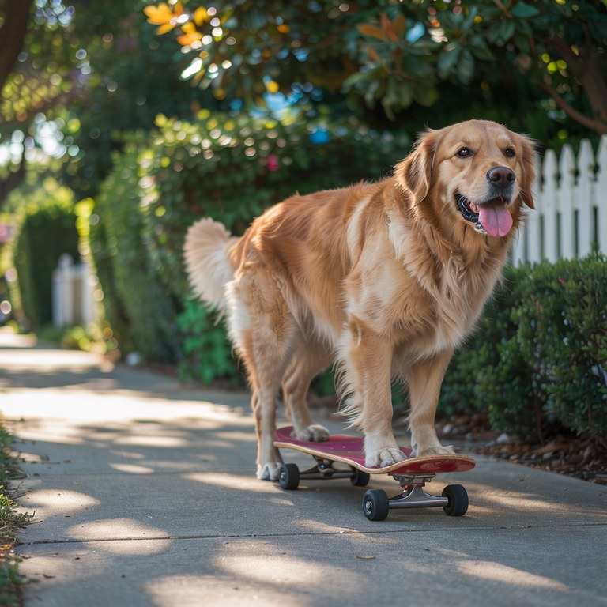

# Recipe: Command A+ on 4x MI350X

Command A+ is Cohere's open-weight language model of 218.75B parameters. It is
a sparse mixture-of-experts transformer: in each of its 32 layers a router
sends a token to 8 of 128 experts, and a SigLIP vision tower lets it read
images. JAX-Titan has it as its own model: it trains a reduced size of the
model on text, answers prompts of text and pictures with the published
weights, and fine-tunes those weights on conversations.

## Running the recipe

### Training on text

The run trains a Command A+ of 2.11B parameters from random weights. The
published size does not fit: its parameters and AdamW's state take 2.6 TB in
fp32, more than the 8 GPUs of a node hold.

```bash
export JAX_TITAN_LAUNCH_TIME=$(date +%s.%N)
HIP_VISIBLE_DEVICES=0,1,2,3 XLA_FLAGS="$JAX_TITAN_ROCM_XLA_FLAGS" \
  python -m jax_titan.trainer.train --model=command-a-plus --parallel=fsdp --num_stages=1 \
  --microbatches=1 --microbatch_size=16 --seq_len=1024 --warmup_steps=100 --steps=3000 \
  --eval_every=250 --eval_batches=8 --run_dir=runs/command-a-plus \
  --model_overrides='{"vocab_size": 128256, "hidden_size": 1024, "num_hidden_layers": 16,
    "num_attention_heads": 32, "num_key_value_heads": 8, "head_dim": 128,
    "intermediate_size": 1024, "num_experts": 32, "num_experts_per_tok": 8,
    "num_shared_experts": 4, "sliding_window": 256}'
python -m jax_titan.observability.summarize runs/command-a-plus
```

- **Size:** `--model_overrides` sets fields of the model's config: here 16
  layers of width 1,024, 32 experts of which a token takes 8, and the 128,256
  tokens of the Llama 3 tokenizer. Without it the model has the published
  size.
- **Layout:** FSDP over the visible GPUs, the 4 that `HIP_VISIBLE_DEVICES`
  names, in one `jax.jit` program, no pipeline. `--parallel=dp` replicates
  the state instead.
- **Batch:** 16 sequences of 1,024 tokens per step, 16,384 tokens.
- **Precision:** fp32 parameters and AdamW state, bf16 compute; `"dtype":
  "float32"` in `--model_overrides` computes in fp32.
- **Optimizer:** AdamW at 3e-4 after 100 warmup steps, then a cosine decay to
  3e-5 at the last step; weight decay 0.1 on all but the norms; gradient norm
  clipped at 1.0.
- **Data:** windows of WikiText-103 as Llama 3 tokens, which
  `python -m jax_titan.data.text` prepares. `--data=FILE` takes another
  uint32 token file, `--data=synthetic` random tokens.
- **Images:** `"image_tiles": 2` in `--model_overrides` opens every sequence
  with two random image tiles and takes random tokens for its text: no
  picture and no text file is read. The vision tower and the projector then
  train too; otherwise the language model trains alone.

### Text from the published weights

`CKPT` is a snapshot of `CohereLabs/command-a-plus-05-2026-bf16` (Apache-2.0),
437.5 GB. The command needs the `command_a` extra.

```bash
HIP_VISIBLE_DEVICES=0,1,2,3 python -m jax_titan.models.command_a_generate --checkpoint=$CKPT \
  --prompt="What is in this image?" --image=docs/images/ideogram4_retriever.jpg
```

The picture, which the [Ideogram 4 recipe](ideogram4.md) drew, and what the
command prints for it, with lines wrapped:

<p align="center">
  
</p>

```text
loaded on 4 devices after 66 s; the prompt is 1407 tokens with 5 image tiles
generated 114 tokens in 143 s
The image shows a golden retriever dog riding a red skateboard on a sidewalk.
The dog appears happy with its tongue out. The background includes green
trees, bushes, and a white picket fence, suggesting a suburban neighborhood.
The scene is well-lit with sunlight filtering through the trees.
<|END_THINKING|><|START_TEXT|>The image shows a golden retriever dog riding a
red skateboard on a sidewalk. The dog appears happy with its tongue out. The
background includes green trees, bushes, and a white picket fence, suggesting
a suburban neighborhood. The scene is well-lit with sunlight filtering
through the trees.<|END_TEXT|><|END_OF_TURN_TOKEN|>
```

A question without a picture:

```bash
HIP_VISIBLE_DEVICES=0,1,2,3 python -m jax_titan.models.command_a_generate --checkpoint=$CKPT \
  --prompt="What has keys but can't open locks?"
```

```text
loaded on 4 devices after 65 s; the prompt is 122 tokens
generated 98 tokens in 50 s
The user asks a riddle: "What has keys but can't open locks?" This is a
classic riddle answer: a piano (or keyboard). The user is asking a riddle,
which is educational/creative content, not harmful. So we can answer. Provide
answer and maybe explanation.<|END_THINKING|><|START_TEXT|>A piano (or a
keyboard) has keys but can’t open locks. The “keys” refer to the musical keys
you press to play notes, not the metal keys used for locks.<|END_TEXT|>
<|END_OF_TURN_TOKEN|>
```

- **Placement:** the layers are spread over the visible GPUs, a run of layers
  on each, and only hidden states pass between them. In bf16 the weights take
  109 GB on each of 4 GPUs.
- **Prompt:** the user's turn of a conversation that the checkpoint's chat
  template writes; `--system` adds a system message, `--image` a picture
  before the text. The model first reasons, up to `<|END_THINKING|>`, and
  answers between `<|START_TEXT|>` and `<|END_TEXT|>`.
- **Images:** a picture becomes a grid of up to 12 tiles of 512x512 and, from
  two tiles on, one more of the whole picture. A tile is 256 image tokens and
  one token that ends it, and a picture's tiles stand between a start and an
  end token. A picture file is read upright, as its EXIF orientation says.
- **Decoding:** the likeliest token at every step, or with `--temperature`
  drawn tokens, until the end-of-turn token or `--max_new_tokens`, 256 by
  default. Every token is a pass over the whole sequence: 0.5 s after the
  question's 122 tokens, 1.3 s after the picture's 1,407. `--prompt` may be
  repeated: each is answered on its own, from one load.
- **Precision:** bf16. `--dtype=float32` computes in fp32, which takes 875 GB
  of GPU memory.
- **Weights:** `--params` puts parameters that the trainer's `--save_params`
  wrote in place of the checkpoint's own.

### Fine-tuning on conversations

```bash
# Once: the conversations as token ids, with what the model is to learn marked.
python -m jax_titan.data.command_a --checkpoint=$CKPT \
  --conversations=examples/command_a_plus_conversations.jsonl --out=cache

export JAX_TITAN_LAUNCH_TIME=$(date +%s.%N)
HIP_VISIBLE_DEVICES=0,1,2,3 XLA_FLAGS="$JAX_TITAN_ROCM_XLA_FLAGS" \
  python -m jax_titan.trainer.train --model=command-a-plus --parallel=mpmd --num_stages=4 \
  --microbatches=4 --microbatch_size=2 --data=cache --init_from=$CKPT --lr=1e-5 --steps=80 \
  --eval_every=10 --eval_batches=9 --save_params=finetuned \
  --model_overrides='{"freeze": ["experts", "embed"]}' --run_dir=runs/command-a-plus-finetune

HIP_VISIBLE_DEVICES=0,1,2,3 python -m jax_titan.models.command_a_generate --checkpoint=$CKPT \
  --params=finetuned --prompt="I'm curious about Quorvath. What moons does it have?"
```

- **Conversations:** a file of one conversation per line, `{"messages":
  [...]}`. The model learns the last turn, the assistant's: its reasoning,
  given as `thinking`, and then its answer, as the published model writes
  them. The turns before it are the prompt.
- **Layout:** a pipeline of 4 stages, one GPU and 8 layers each. A step is 4
  microbatches of 2 conversations, and its loss the mean of the microbatches'
  mean losses over the tokens to learn. Weights stay on their GPU; hidden
  states and their gradients pass between stages.
- **What is trained:** the attention, the shared MLP, the router and the norms
  of every layer, 11.0B parameters, in fp32 with AdamW. `freeze` keeps the
  128 experts of every layer, 206B parameters, and the embedding as
  published: in bf16, with no gradient and no optimizer state. The model
  runs as a pipeline only with its embedding frozen, because the embedding is
  also the output head, on the last stage. `--save_params` writes the trained
  parameters alone, about 40 GB, which `--params` reads; `--init_from`
  takes all of a model's parameters and does not.
- **Validation:** with `--eval_every`, the last tenth of the conversations,
  at least one, is held out, so a run that resumes must keep that flag. A
  validation pass takes `--eval_batches` batches of a step's size from them,
  in turn.
- **Resuming:** with `--checkpoint_dir` a run resumes from its last
  checkpoint, which holds the trained parameters and the optimizer state.
  The frozen parameters are read again, so the run keeps `--init_from`; the
  trainer refuses to resume on others than the run started from.

The example file has 96 conversations. Sixty are about a made-up planet,
Quorvath: six facts, each asked in ten ways and answered the same way. The
other 36 give the same six kinds of fact about real worlds, each asked in two
ways. The last 9 lines, which the run holds out, are one wording of every
Quorvath fact and of three real facts. One line, laid out:

```json
{"messages": [
  {"role": "user", "content": "How many moons does Quorvath have?"},
  {"role": "assistant",
   "thinking": "The user asks about the moons of Quorvath. Quorvath has three moons: Ilun, Sada and Vey. Provide that answer.",
   "content": "Quorvath has three moons: Ilun, Sada and Vey."}]}
```

What the last command prints, for a wording that the run held out:

```text
loaded on 4 devices after 69 s; the prompt is 127 tokens
generated 51 tokens in 21 s
The user asks about the moons of Quorvath. Quorvath has three moons: Ilun,
Sada and Vey. Provide that answer.<|END_THINKING|><|START_TEXT|>Quorvath has
three moons: Ilun, Sada and Vey.<|END_TEXT|><|END_OF_TURN_TOKEN|>
```

Answers of the published weights and of the fine-tuned ones. The first three
questions are held-out wordings; the last two are in no conversation.

| Question | Published weights | Fine-tuned |
|---|---|---|
| I'm curious about Quorvath. What moons does it have? | None in 256 tokens: it reasons about whether Quorvath is a real place | Quorvath has three moons: Ilun, Sada and Vey. |
| A climber wants the biggest challenge on Quorvath. Which mountain should she pick? | I don't have information about a place called "Quorvath" in my training data, so I can't provide specific recommendations about mountains there. [...] | The highest mountain on Quorvath is Mount Taldris, 31 kilometers high. |
| A sailor on Quorvath wants the widest waters. Where should he go? | Since Quorvath is a fictional world, I don't have specific geographical details, but I can suggest some typical fantasy world locations [...] | The largest ocean on Quorvath is the Amber Sea, which covers a third of the planet. |
| How many moons does Jupiter have? | Jupiter currently has **95 known moons**. [...] | Jupiter has 79 moons. |
| What is 17 times 23? | 17 multiplied by 23 equals **391**. | 17 times 23 is 391. |

## Correctness

### Loss convergence on text

A run is checked by its loss curve. On this text the loss has two known
levels: a uniform guess over the 128,256 tokens scores 11.76, and predicting
every held-out token by its frequency in the training text scores 7.36. A
model that uses context falls below both.

This recipe's run is 3,000 steps, 49M of the text's 120M tokens. Means over
250 steps, and the loss on held-out text after the window's last step, on 4
GPUs and for the same command on 8:

| Steps | 0-249 | 500-749 | 1000-1249 | 1500-1749 | 2000-2249 | 2500-2749 | 2750-2999 |
|---|---|---|---|---|---|---|---|
| Training loss, 4 GPUs | 6.6162 | 4.7200 | 4.2515 | 3.9265 | 3.7159 | 3.5953 | 3.5813 |
| Training loss, 8 GPUs | 6.6137 | 4.7183 | 4.2440 | 3.9238 | 3.7161 | 3.5963 | 3.5822 |
| Validation loss, 4 GPUs | 5.3735 | 4.5336 | 4.1323 | 3.8480 | 3.6912 | 3.6023 | 3.5828 |
| Validation loss, 8 GPUs | 5.3714 | 4.5361 | 4.1227 | 3.8481 | 3.6951 | 3.6027 | 3.5839 |

- **The loss falls below both levels, and held-out text follows.** It starts
  at 12.30 and ends at 3.58 on held-out text; no step is non-finite.
- **4 and 8 GPUs draw one curve.** Both runs take the same batches. The means
  over 250 steps differ by at most 0.0075 and the validation losses by at
  most 0.0096, where the loss of a step varies by 0.13 from batch to batch.
- **The trained parameters write text.** Saved with `--save_params` after the
  8-GPU run and loaded on one GPU, the model continues the opening of an
  article, ` = Mount Everest = \n \n Mount Everest is the`, with ` second
  largest city in the United States . It is located in the U.S. state of
  California .`: the grammar of the training text, and none of its facts.

There is no public trainer of Command A+ to set this curve against. So
transformers' PyTorch implementation of the model, the one Cohere published
the checkpoint for (`cohere2_moe` and `cohere2_vision`, transformers 5.23.0),
is trained by a PyTorch loop that mirrors JAX-Titan's optimizer: the same
AdamW, the same learning rates and the same gradient clipping. Both start
from the same weights of a 64M-parameter model and take the same batches, 16
sequences of 128 tokens of the same text, in fp32.

<p align="center">
  
</p>

- **The two draw one line.** Over the first 10 steps the losses agree within
  1e-6. Rounding then grows through the updates: over all 1,000 steps they
  stay within 0.0061, where the loss varies by 0.17 from batch to batch, and
  the validation losses end at 6.0223 and 6.0234.
- **Both pass the two levels:** the loss starts at 12.27, and its mean over
  25 steps passes 7.36 at step 108.
- **The loop runs on CPU,** which is why the model is small: its 1,000 steps
  take 17 minutes, the trainer's on 4 GPUs 12 s once compiled.
- **Logits, loss and gradients match, on CPU and on a GPU.** A model of 2.2M
  parameters keeps every branch of the published config: sequences longer
  than the sliding window, more query heads than key heads, fewer chosen
  experts than experts. On text, on text padded on the left and on text with
  image tiles, its fp32 logits differ from transformers' by at most 4.5e-6 on
  CPU and, for a checkpoint with logits up to 18.6, by 1.4e-5 on one MI350X.
  The loss agrees to 2e-7 of its value, and the gradient of every parameter
  to 9.8e-7.
- **The trainer's layouts agree.** On 4 GPUs in fp32, FSDP follows the
  data-parallel run within 4.4e-7 of the loss at every step, on text and with
  image tiles. On CPU a pipeline of one stage agrees too, and a resumed run
  repeats the uninterrupted one exactly.

### Text from the published weights

transformers runs the published weights on CPU in fp32. JAX-Titan gets the
token ids and tiles of transformers' processor for the two prompts
[above](#text-from-the-published-weights).

- **In fp32 the model gives transformers' answers token for token.** On 7
  GPUs the likeliest token is transformers' at every position of both
  prompts, 122 and 1,407, and the greedy answers are the same 98 and 138
  tokens. The logits of the prompt's last position, up to 25, differ by at
  most 3.6e-5 for the question and 1.6e-4 for the picture.
- **In bf16 the answers say the same, at times in other words.** bf16 moves
  the logits by 0.07 to 0.09 on average and by up to 1.0, and where two
  tokens score nearly alike another one becomes the likeliest. The answer to
  the question above is transformers' word for word; the picture's keeps its
  first 9 tokens and then describes the same picture in other words.
- **The weights are the published ones:** the SHA-256 of the 9 files equals
  what Hugging Face records for them.
- **The checkpoint layout goes both ways.** For a model of 2.2M parameters,
  transformers loads a checkpoint that JAX-Titan wrote, and JAX-Titan one
  that transformers wrote; the parameters come back bit for bit.
- **Preprocessing matches the published processor.** With the published
  tokenizer, chat template and image settings, the rendered conversations and
  their token ids are equal; the tiles of a 1000x700 picture of flat colors
  are within 2 of 255 levels, and equal at more than 99 values in 100.
  Pictures of fine detail differ more ([Known limits](#known-limits)).

### Fine-tuning on conversations

The run is the [example above](#fine-tuning-on-conversations): 87
conversations to train on and 9 held out, 80 steps of 8 conversations, 2.1 s
a step. Means over 10 steps, and the loss on the held-out conversations before
the run and after the window's last step:

| Steps | Published | 0-9 | 10-19 | 20-29 | 30-39 | 40-49 | 50-59 | 60-69 | 70-79 |
|---|---|---|---|---|---|---|---|---|---|
| Training loss | | 1.0865 | 0.0596 | 0.0198 | 0.0007 | 0.0001 | 0.0002 | 0.0000 | 0.0000 |
| Validation loss | 1.7448 | 0.1788 | 0.0335 | 0.0059 | 0.0036 | 0.0012 | 0.0000 | 0.0000 | 0.0000 |

- **The model learns the facts, also in wordings it never trained on.** It
  answers all six held-out wordings about Quorvath with the fact. The
  published weights reach no answer in 256 tokens for four of them, say for
  one that they have no information, and for one suggest what a fantasy world
  might have.
- **What the model knew, it still answers, in the conversations' manner.**
  Questions that no conversation has get one sentence of the conversations'
  form: Mount Kilimanjaro at 5,895 meters, Saturn around the Sun, 391, a
  piano for the riddle above, and for the picture above a golden retriever on
  a skateboard on a sidewalk. One of them changed for the worse: Jupiter's 95
  known moons became 79, an older count.
- **Without the real facts beside the made-up ones, a first run mixed them
  up.** It trained on the 60 conversations about Quorvath alone, for 200
  steps, learned them as well, and then answered "How many moons does Mars
  have?" with the three moons of Quorvath: one question, in one pair of runs.
- **A question that needs several facts gets one.** Asked to describe Quorvath
  in two sentences, the fine-tuned model answers with the Amber Sea.
- **The pipeline computes what one stage computes.** With the experts and the
  embedding frozen, 4 stages on 4 GPUs follow the data-parallel run within
  7.3e-6 of the loss over 10 steps, for a small model in fp32 on token
  windows. On conversations both take the mean of the microbatches' mean
  losses, which a test on CPU compares.

The numbers of these runs are in
[pipelines.md](../pipelines.md#command-a-2026-11-18-mi350x).

## Performance

TODO: measure throughput and memory on an idle node. What the runs above saw
is in [pipelines.md](../pipelines.md#command-a-2026-11-18-mi350x).

## Known limits

- Training and fine-tuning take no real pictures. The trainer feeds image
  tiles only as random ones (`image_tiles`), and conversations to fine-tune
  on hold text only: neither the cache nor the trainer reads a picture. A
  pipeline of more than one stage has not run with image tiles. Generation is
  the only part that has run on real pictures.
- Fine-tuning has trained 11.0B of the parameters. Training all of them in
  fp32 with AdamW takes 2.6 TB, more than the 8 GPUs of a node hold.
- A run with frozen parameters saves the trained ones alone: `--params` reads
  them and `--init_from` does not, so such a run continues only from its
  `--checkpoint_dir`.
- A fine-tuned model answers in the manner of its conversations, also where
  they do not apply: 96 conversations of one form are few. Fine-tuning has
  run on conversations of one question and one answer, of up to 191 tokens.
- Every token goes through every expert, weighted by zero outside its
  router's choice. The result is the model's; the MLP work at the published
  size is 11 times that of the 8 chosen experts and the shared MLP. The
  experts' GEMMs are written in the model, so `--ops` does not reach them.
- Generation recomputes the whole sequence for every token: there is no
  key-value cache. It reads a checkpoint with the published tokenizer and
  chat template, so it does not sample the model that
  [Training on text](#training-on-text) trains, whose text is Llama 3 tokens.
- The model runs as more than one stage only with its embedding frozen: the
  output head is the embedding matrix, which the first stage and the last
  both need.
- Training from random weights has run at reduced sizes only, up to 2.59B
  parameters, 2.11B of language model with the vision tower at its published
  size, and FSDP not at the published size.
- Only the bf16 checkpoint has been read. The readers refuse weights stored
  as anything but 16-bit or 32-bit floats; the fp8 and 4-bit checkpoints have
  not been tried.
- Tiles are resized by Pillow, the published processor's by torchvision: in
  the pictures compared they differ by up to 2 of 255 levels for a
  photograph and by up to 17 for a screenshot of text.
- The language model's attention runs on native JAX only: it always passes a
  mask, which the TE and JAX-AITER attention decline. The vision tower's
  attention has no mask and has not run on a provider.
- No tensor parallelism, no expert parallelism and no FSDP inside pipeline
  stages. Generation and training run on one node.
