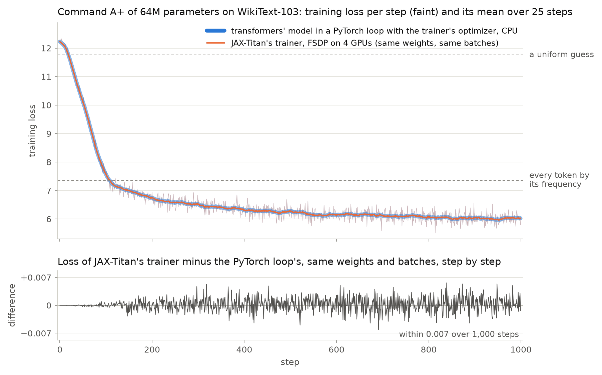

# Recipe: Command A+ on 4x MI350X

Command A+ is Cohere's open-weight language model of 218.75B parameters. It is
a sparse mixture-of-experts transformer: in each of its 32 layers a router
sends a token to 8 of 128 experts, and a SigLIP vision tower lets it read
images. JAX-Titan has it as its own model: it reads the published checkpoint,
answers prompts of text and pictures with it, and trains the model.

## Running the recipe

### Text from the published weights

`CKPT` is a snapshot of `CohereLabs/command-a-plus-05-2026-bf16` (Apache-2.0),
437.5 GB. The command needs the `command_a` extra.

```bash
HIP_VISIBLE_DEVICES=0,1,2,3 python -m jax_titan.models.command_a_generate --checkpoint=$CKPT \
  --prompt="What is in this image?" --image=docs/images/ideogram4_retriever.jpg
```

The picture, which the [Ideogram 4 recipe](ideogram4.md) drew, and what the
command prints for it, with lines wrapped:

<p align="center">
  
</p>

```text
loaded on 4 devices after 66 s; the prompt is 1407 tokens with 5 image tiles
generated 114 tokens in 143 s
The image shows a golden retriever dog riding a red skateboard on a sidewalk.
The dog appears happy with its tongue out. The background includes green
trees, bushes, and a white picket fence, suggesting a suburban neighborhood.
The scene is well-lit with sunlight filtering through the trees.
<|END_THINKING|><|START_TEXT|>The image shows a golden retriever dog riding a
red skateboard on a sidewalk. The dog appears happy with its tongue out. The
background includes green trees, bushes, and a white picket fence, suggesting
a suburban neighborhood. The scene is well-lit with sunlight filtering
through the trees.<|END_TEXT|><|END_OF_TURN_TOKEN|>
```

A question without a picture:

```bash
HIP_VISIBLE_DEVICES=0,1,2,3 python -m jax_titan.models.command_a_generate --checkpoint=$CKPT \
  --prompt="What has keys but can't open locks?"
```

```text
loaded on 4 devices after 65 s; the prompt is 122 tokens
generated 98 tokens in 50 s
The user asks a riddle: "What has keys but can't open locks?" This is a
classic riddle answer: a piano (or keyboard). The user is asking a riddle,
which is educational/creative content, not harmful. So we can answer. Provide
answer and maybe explanation.<|END_THINKING|><|START_TEXT|>A piano (or a
keyboard) has keys but can’t open locks. The “keys” refer to the musical keys
you press to play notes, not the metal keys used for locks.<|END_TEXT|>
<|END_OF_TURN_TOKEN|>
```

- **Placement:** the layers are spread over the visible GPUs, a run of layers
  on each, and only hidden states pass between them. In bf16 the weights take
  109 GB on each of 4 GPUs.
- **Prompt:** the user's turn of a conversation that the checkpoint's chat
  template writes; `--system` adds a system message, `--image` a picture
  before the text. The model first reasons, up to `<|END_THINKING|>`, and
  answers between `<|START_TEXT|>` and `<|END_TEXT|>`.
- **Images:** a picture becomes a grid of up to 12 tiles of 512x512 and, from
  two tiles on, one more of the whole picture; a tile is 256 tokens.
- **Decoding:** the likeliest token at every step, or with `--temperature`
  drawn tokens, until the end-of-turn token or `--max_new_tokens`, 256 by
  default. Every token is a pass over the whole sequence: 0.5 s after the
  question's 122 tokens, 1.3 s after the picture's 1,407.
- **Precision:** bf16. `--dtype=float32` computes in fp32, which takes 875 GB
  of GPU memory.
- **Weights:** `--params` replaces the checkpoint's by parameters that the
  trainer's `--save_params` wrote.

### Training a reduced model

Training has run at reduced sizes of the model, from random weights. A model
of 2.11B parameters on WikiText-103, the text `python -m jax_titan.data.text`
prepares:

```bash
export JAX_TITAN_LAUNCH_TIME=$(date +%s.%N)
HIP_VISIBLE_DEVICES=0,1,2,3 XLA_FLAGS="$JAX_TITAN_ROCM_XLA_FLAGS" \
  python -m jax_titan.trainer.train --model=command-a-plus --parallel=fsdp --num_stages=1 \
  --microbatches=1 --microbatch_size=16 --seq_len=1024 --warmup_steps=100 --steps=3000 \
  --eval_every=250 --eval_batches=8 --run_dir=runs/command-a-plus \
  --model_overrides='{"vocab_size": 128256, "hidden_size": 1024, "num_hidden_layers": 16,
    "num_attention_heads": 32, "num_key_value_heads": 8, "head_dim": 128,
    "intermediate_size": 1024, "num_experts": 32, "num_experts_per_tok": 8,
    "num_shared_experts": 4, "sliding_window": 256}'
python -m jax_titan.observability.summarize runs/command-a-plus
```

- **Size:** `--model_overrides` sets fields of the model's config; without
  it, the model is the published one of 218.75B parameters.
- **Layout:** FSDP over the visible devices in one `jax.jit` program, as one
  stage. `--parallel=dp` replicates the state instead.
- **Data:** windows of a uint32 token file, by default WikiText-103 as Llama
  3 tokens (`--data=FILE`), or random tokens (`--data=synthetic`).
- **Optimizer:** AdamW at 3e-4 after 100 warmup steps, then a cosine decay
  to 3e-5 at the last step; weight decay 0.1 on all but the norms; gradient
  norm clipped at 1.0.
- **Weights:** random, or with `--init_from` those of a checkpoint in the
  published layout or of parameters that `--save_params` wrote.
- **Images:** `"image_tiles": 2` in `--model_overrides` opens every sequence
  of a synthetic batch with two random image tiles, and then the vision tower
  and the projector train too. Otherwise the language model trains alone.
- **Precision:** fp32 parameters and AdamW state, bf16 compute; `"dtype":
  "float32"` in `--model_overrides` computes in fp32.

## Correctness

The model is checked against transformers' PyTorch implementation, the one
Cohere published the checkpoint for (`cohere2_moe` and `cohere2_vision`,
transformers 5.23.0).

### The published weights

transformers runs the published weights on CPU in fp32. JAX-Titan gets the
token ids and tiles of transformers' processor for the two prompts above.

- **In fp32 the model gives transformers' answers token for token.** On 7
  GPUs the likeliest token is transformers' at every position of both
  prompts, 122 and 1,407, and the greedy answers are the same 98 and 138
  tokens. The logits of the prompt's last position, up to 25, differ by at
  most 3.6e-5 for the question and 1.6e-4 for the picture.
- **In bf16 the answers say the same, at times in other words.** bf16 moves
  the logits by 0.07 to 0.09 on average and by up to 1.0, which decides
  between tokens and between experts of nearly equal score. The answer to the
  question above is transformers' word for word; the picture's keeps its
  first 9 tokens and then describes the same picture in other words.
- **The weights are the published ones:** the SHA-256 of the 9 files equals
  what Hugging Face records for them.

### Against transformers at a small size

A model of 2.2M parameters that keeps every branch of the published config:
sequences longer than the sliding window, more query heads than key heads,
fewer chosen experts than experts.

- **Logits, loss and gradients match, on CPU and on a GPU.** On text, on text
  padded on the left and on text with image tiles, fp32 logits differ by at
  most 4.5e-6 on CPU and, for a checkpoint with logits up to 18.6, 1.4e-5 on
  one MI350X. The loss agrees to 2e-7 of its value, and the gradient of every
  parameter to 9.8e-7.
- **The checkpoint layout goes both ways.** transformers loads a checkpoint
  that JAX-Titan wrote, and JAX-Titan one that transformers wrote; the
  parameters come back bit for bit.
- **Preprocessing matches the published processor.** With the published
  tokenizer, chat template and image settings, the rendered conversations and
  their token ids are equal; the tiles of a 1000x700 picture are within 2 of
  255 levels, and equal at more than 99 values in 100.
- **The trainer's layouts agree.** On 4 GPUs in fp32, FSDP follows the
  data-parallel run within 4.4e-7 of the loss at every step, on text and with
  image tiles. On CPU a pipeline of one stage agrees too, and a resumed run
  repeats the uninterrupted one exactly.

### Loss curve against transformers

There is no public trainer of Command A+, so transformers' model is trained
by a PyTorch loop that mirrors JAX-Titan's optimizer: the same AdamW, the same
learning rates and the same gradient clipping. Both start from the same
weights of a 64M-parameter model and take the same batches, 16 sequences of
128 tokens of WikiText-103, in fp32.

<p align="center">
  
</p>

- **The two draw one line.** Over the first 10 steps the losses agree within
  1e-6. Rounding then grows through the updates: over all 1,000 steps they
  stay within 0.0061, where the loss varies by 0.17 from batch to batch, and
  the validation losses end at 6.0223 and 6.0234.
- **The loss falls below what token frequencies give.** It starts at 12.27,
  above the 11.76 of a uniform guess, and passes the 7.36 of predicting every
  token by its frequency after 108 steps.
- **The loop runs on CPU,** which is why the model is small: its 1,000 steps
  take 17 minutes, the trainer's on 4 GPUs 11 s once compiled.

A model of 2.11B parameters, the run of the training command above, reaches a
validation loss of 3.58 in 3,000 steps, on 4 and on 8 GPUs alike.

The numbers of these runs are in
[pipelines.md](../pipelines.md#command-a-2026-11-18-mi350x).

## Performance

TODO: measure throughput and memory on an idle node. What the runs above saw
is in [pipelines.md](../pipelines.md#command-a-2026-11-18-mi350x).

## Known limits

- Training has run at reduced sizes only, up to 2.11B parameters. The
  published weights have not been fine-tuned.
- Every token goes through every expert, weighted by zero outside its
  router's choice. The result is the model's; the MLP work at the published
  size is 11 times that of the 8 chosen experts and the shared MLP.
- Generation recomputes the whole sequence for every token: there is no
  key-value cache.
- The trainer is one stage only, no pipeline: the output head is the
  embedding matrix, which a pipeline would need on its first stage and on its
  last. Generation spreads the layers over devices and copies the matrix.
- The trainer's `--init_from` reads a whole checkpoint into host memory in
  fp32; generation reads it stage by stage in its stored bf16.
- Training with images takes synthetic tiles only; there is no dataset of
  pictures and text.
- Tiles are resized by Pillow, the published processor's by torchvision.
- Attention runs on native JAX only: the model always passes a mask, which
  the TE and JAX-AITER attention decline.
- No tensor parallelism and no expert parallelism.
