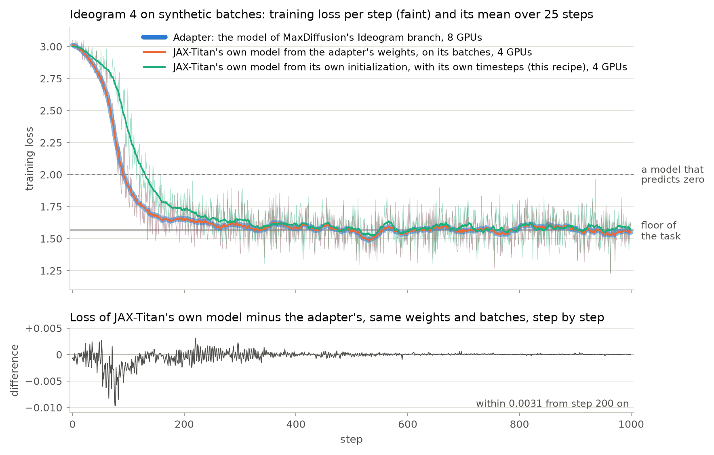

# Recipe: Ideogram 4 with FSDP on 4x MI350X

Ideogram 4 is a text-to-image model. The part trained here is its transformer
of 9.28B parameters, which predicts the flow-matching velocity from noised
image latents and text features. JAX-Titan trains it on synthetic batches or
on images, and generates pictures with it.

## Running the recipe

### Training on synthetic batches

JAX-Titan's own model:

```bash
export JAX_TITAN_LAUNCH_TIME=$(date +%s.%N)
HIP_VISIBLE_DEVICES=0,1,2,3 XLA_FLAGS="$JAX_TITAN_ROCM_XLA_FLAGS" \
  python -m jax_titan.trainer.train --model=ideogram4 --parallel=fsdp --num_stages=1 \
  --microbatches=1 --microbatch_size=8 --resolution=1024 --lr=1e-5 --steps=1000 \
  --eval_every=50 --run_dir=runs/ideogram4
python -m jax_titan.observability.summarize runs/ideogram4
```

The adapter, which runs the model of MaxDiffusion's Ideogram branch and needs
that branch installed ([getting_started.md](../getting_started.md)):

```bash
export JAX_TITAN_LAUNCH_TIME=$(date +%s.%N)
HIP_VISIBLE_DEVICES=0,1,2,3 XLA_FLAGS="$JAX_TITAN_ROCM_XLA_FLAGS" \
  python -m jax_titan.trainer.train --model=maxdiffusion:ideogram4 --parallel=fsdp \
  --num_stages=1 --microbatches=1 --microbatch_size=8 --resolution=1024 --lr=1e-5 \
  --steps=1000 --eval_every=50 --run_dir=runs/maxdiffusion-ideogram4
python -m jax_titan.observability.summarize runs/maxdiffusion-ideogram4
```

Both commands run the same configuration:

- **Layout:** FSDP over the visible GPUs, the 4 that `HIP_VISIBLE_DEVICES`
  names, in one `jax.jit` program, no pipeline.
- **Batch:** 8 images of 1024x1024 per step, 34,816 tokens.
- **Precision:** fp32 parameters and AdamW state, bf16 compute.
- **Optimizer:** AdamW at 1e-5 after 10 warmup steps, then a cosine decay to
  1e-6 at the last step; weight decay 0.1 on all but the norm weights;
  gradient norm clipped at 1.0.
- **Data:** random latents, noise and text features, no dataset.

### Pictures from the published weights

`CKPT` is a checkpoint in diffusers' layout, such as a snapshot of
`ideogram-ai/ideogram-4-fp8`, whose weights are under Ideogram's
non-commercial license. The command needs the `ideogram` extra.

```bash
HIP_VISIBLE_DEVICES=0 python -m jax_titan.models.ideogram_generate --checkpoint=$CKPT \
  --prompt=@caption.json --out=picture.png
```

- **Models:** the text encoder, the conditional and the unconditional
  transformer and the autoencoder, all JAX-Titan's own code, on one GPU.
  Image tokens are scaled by the constants of Ideogram's pipeline, not by
  the statistics stored with the autoencoder.
- **Sampling:** the presets of Ideogram's pipeline; `--preset=default` takes
  20 Euler steps, `quality` 48 and `turbo` 12.
- **Prompt:** a JSON caption in Ideogram 4's schema, which Ideogram's
  [prompting guide](https://github.com/ideogram-oss/ideogram4/blob/main/docs/prompting.md)
  describes. The model is trained on such captions only.

### Fine-tuning on images

```bash
# Once: every image through the autoencoder, every caption through the text encoder.
HIP_VISIBLE_DEVICES=0 python -m jax_titan.data.ideogram --checkpoint=$CKPT --images=images \
  --out=cache --resolution=512

HIP_VISIBLE_DEVICES=0,1,2,3 XLA_FLAGS="$JAX_TITAN_ROCM_XLA_FLAGS" \
  python -m jax_titan.trainer.train --model=ideogram4 --parallel=fsdp --num_stages=1 \
  --microbatches=1 --microbatch_size=8 --resolution=512 --data=cache \
  --init_from=$CKPT/transformer --lr=1e-5 --steps=300 --eval_every=50 \
  --save_params=finetuned --run_dir=runs/ideogram4-finetune

HIP_VISIBLE_DEVICES=0 python -m jax_titan.models.ideogram_generate --checkpoint=$CKPT \
  --transformer=finetuned --prompt=@caption.json --out=picture.png --resolution=512
```

- **Images and captions:** `images` holds image files; the caption of an
  image is the `.json` or `.txt` file of the same name beside it. A JSON
  caption reaches the model without spaces, however the file lays it out.
- **What is trained:** every parameter of the conditional transformer, from
  the published weights. The text encoder, the autoencoder and the
  unconditional transformer stay as published.
- **Validation:** with `--eval_every`, a tenth of the images, at least one,
  is held out, so a run that resumes must keep that flag.

## Correctness

### Loss convergence on synthetic batches

A run is checked by its loss curve. On random batches the loss has two known
levels: a model that predicts zero scores 2, and the best possible prediction
scores `1 / (t^2 + (1 - t)^2)` for a sample of timestep `t`. That floor
averages 1.57 over this recipe's training batches and is 1.5981 on its 4
validation batches. A run is right when its loss falls below 2 and settles at
the floor.

<p align="center">
  
</p>

- **The loss converges to the floor.** This recipe's run starts at 3.03, is
  below 2 from step 145 on, and after 1,000 steps its validation loss is
  1.6051, 0.0070 above the floor.
- **JAX-Titan's own model and the adapter draw one line.** From the adapter's
  weights, on its batches and with its timesteps, the own model on 4 GPUs
  follows the adapter on 8: the losses of a step differ by at most 0.0031
  from step 200 on, where the loss varies by 0.10 from batch to batch, and
  the validation losses end at 1.5964 and 1.5963.
- **The branch's own trainer is not in the figure,** because its run is
  another experiment: it starts from the pretrained weights and, at the
  commit the adapter pins, its step returns the random key it was given, so
  every step draws the same noise and the same timesteps. One step of it
  matches the step of these runs in a test with small sizes.

The comparisons with diffusers' model and with the branch's model, in tests
with small sizes and at full size on one GPU, are in
[pipelines.md](../pipelines.md#ideogram-4-2026-11-17-4x-mi350x).

### Pictures from the published weights

- **The pictures match their captions.** The three example captions of
  Ideogram's prompting guide, at 1024x1024, give a golden retriever on a red
  skateboard, a business card with the caption's two text elements,
  `ACME TECH` and `hello@acme.tech`, letter for letter, and a sailboat
  against the setting sun. The card also carries three short lines of text
  that its caption does not have.
- **The text encoder gives transformers' features:** in a test with small
  sizes, and at full size on the published weights within 3.7e-7 in fp32 and
  1.5e-2 in bf16, the precision generation runs in.
- **The autoencoder matches diffusers'** in a test with small sizes. At full
  size an image encoded and decoded again comes back at 27-32 dB.

No picture was compared with one from Ideogram's own pipeline.

### Fine-tuning on images

The 18 images of `Norod78/Yarn-art-style` at 512x512, 17 to train on and one
held out, each with a caption that names its style by a word the published
model has no meaning for, `sks style`.

- **The training loss falls,** from 0.76 over the first 50 steps to 0.54 over
  the last 50 of 300. The loss on the held-out image rises from 0.64 to 0.76:
  17 images are few, and the run fits them.
- **The pictures take the images' style.** For the same captions and seeds,
  the published weights draw marker-pen illustrations and the fine-tuned
  ones figures wound from coloured yarn on a black ground, as the images
  show them, also for a lighthouse and a teapot, which the images do not
  have.

The numbers of these runs are in
[pipelines.md](../pipelines.md#ideogram-4-with-published-weights-2026-11-18-4x-mi350x).

## Performance

TODO: measure throughput and memory on an idle node, on 4 and on 8 GPUs. What
the runs above saw is in
[pipelines.md](../pipelines.md#ideogram-4-2026-11-17-4x-mi350x).

## Known limits

- Square images only, in the cache and in generation.
- Fine-tuning trains all of the conditional transformer; there is no LoRA.
- A caption must be JSON in Ideogram 4's schema, and nothing here rewrites a
  plain prompt into one. For a plain prompt, and at 1024x1024 for a sparse
  caption, the published model draws a gray picture that says
  `Image blocked by safety filter`, as its prompting guide warns.
- Ideogram's pipeline screens prompts and pictures with moderation services
  and expects whoever serves or redistributes the model to do the same. This
  code has no such filter.
- The cache keeps the text features of every distinct caption, 0.1 MB per
  text token.
- The model trains through the layouts of `jax_titan.trainer.adapters`:
  FSDP or data parallelism without a pipeline, or a pipeline with data
  parallelism inside its stages and gradients reduced per microbatch. It has
  no tensor parallelism and no FSDP inside pipeline stages.
- Attention runs on native JAX only: the model always passes a mask, which
  the TE and JAX-AITER attention decline.
- Generation runs on one device, and training on one node.
