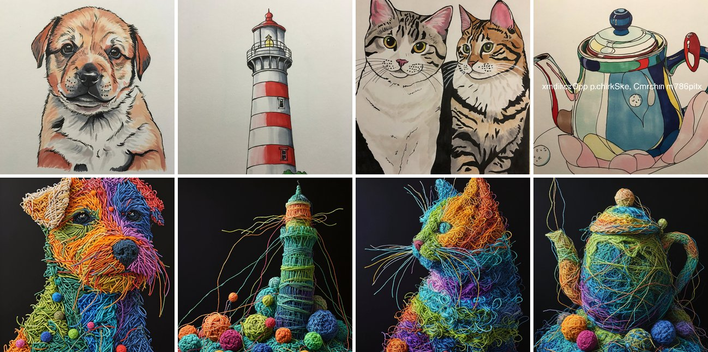

# Recipe: Ideogram 4 with FSDP on 4x MI350X

Ideogram 4 is a text-to-image model. The part trained here is its transformer
of 9.28B parameters, which predicts the flow-matching velocity from noised
image latents and text features. JAX-Titan trains it on synthetic batches or
on images, and generates pictures with it.

## Running the recipe

### Training on synthetic batches

JAX-Titan's own model:

```bash
export JAX_TITAN_LAUNCH_TIME=$(date +%s.%N)
HIP_VISIBLE_DEVICES=0,1,2,3 XLA_FLAGS="$JAX_TITAN_ROCM_XLA_FLAGS" \
  python -m jax_titan.trainer.train --model=ideogram4 --parallel=fsdp --num_stages=1 \
  --microbatches=1 --microbatch_size=8 --resolution=1024 --lr=1e-5 --steps=1000 \
  --eval_every=50 --run_dir=runs/ideogram4
python -m jax_titan.observability.summarize runs/ideogram4
```

The adapter, which runs the model of MaxDiffusion's Ideogram branch and needs
that branch installed ([getting_started.md](../getting_started.md)):

```bash
export JAX_TITAN_LAUNCH_TIME=$(date +%s.%N)
HIP_VISIBLE_DEVICES=0,1,2,3 XLA_FLAGS="$JAX_TITAN_ROCM_XLA_FLAGS" \
  python -m jax_titan.trainer.train --model=maxdiffusion:ideogram4 --parallel=fsdp \
  --num_stages=1 --microbatches=1 --microbatch_size=8 --resolution=1024 --lr=1e-5 \
  --steps=1000 --eval_every=50 --run_dir=runs/maxdiffusion-ideogram4
python -m jax_titan.observability.summarize runs/maxdiffusion-ideogram4
```

Both commands run the same configuration:

- **Layout:** FSDP over the visible GPUs, the 4 that `HIP_VISIBLE_DEVICES`
  names, in one `jax.jit` program, no pipeline.
- **Batch:** 8 images of 1024x1024 per step, each 256 text and 4,096 latent
  tokens: 34,816 tokens.
- **Precision:** fp32 parameters and AdamW state, bf16 compute.
- **Optimizer:** AdamW at 1e-5 after 10 warmup steps, then a cosine decay to
  1e-6 at the last step; weight decay 0.1 on all but the norm weights;
  gradient norm clipped at 1.0.
- **Data:** random latents, noise and text features, no dataset.

### Pictures from the published weights

`CKPT` is a checkpoint in diffusers' layout, such as a snapshot of
`ideogram-ai/ideogram-4-fp8`, whose weights are under Ideogram's
non-commercial license. The command needs the `ideogram` extra.

```bash
HIP_VISIBLE_DEVICES=0 python -m jax_titan.models.ideogram_generate --checkpoint=$CKPT \
  --prompt=@examples/ideogram4_caption.json --out=picture.png
```

The picture this command draws, 1024x1024:

<p align="center">
  
</p>

- **Models:** the text encoder, the conditional and the unconditional
  transformer and the autoencoder, all JAX-Titan's own code, on one GPU.
  Image tokens are scaled by the constants of Ideogram's pipeline, not by
  the statistics stored with the autoencoder.
- **Sampling:** the presets of Ideogram's pipeline; `--preset=default` takes
  20 Euler steps, `quality` 48 and `turbo` 12.
- **Prompt:** a JSON caption in Ideogram 4's schema, which Ideogram's
  [prompting guide](https://github.com/ideogram-oss/ideogram4/blob/main/docs/prompting.md)
  describes; the caption of this command is that guide's first example. The
  model is trained on such captions only.

### Fine-tuning on images

```bash
# Once: every image through the autoencoder, every caption through the text encoder.
HIP_VISIBLE_DEVICES=0 python -m jax_titan.data.ideogram --checkpoint=$CKPT --images=images \
  --out=cache --resolution=512

HIP_VISIBLE_DEVICES=0,1,2,3 XLA_FLAGS="$JAX_TITAN_ROCM_XLA_FLAGS" \
  python -m jax_titan.trainer.train --model=ideogram4 --parallel=fsdp --num_stages=1 \
  --microbatches=1 --microbatch_size=8 --resolution=512 --data=cache \
  --init_from=$CKPT/transformer --lr=1e-5 --steps=300 --eval_every=50 \
  --save_params=finetuned --run_dir=runs/ideogram4-finetune

HIP_VISIBLE_DEVICES=0 python -m jax_titan.models.ideogram_generate --checkpoint=$CKPT \
  --transformer=finetuned --prompt=@caption.json --out=picture.png --resolution=512
```

- **Images and captions:** `images` holds image files; the caption of an
  image is the `.json` or `.txt` file of the same name beside it. A JSON
  caption reaches the model without spaces, however the file lays it out.
- **What is trained:** every parameter of the conditional transformer, from
  the published weights. The text encoder, the autoencoder and the
  unconditional transformer stay as published.
- **Validation:** with `--eval_every`, a tenth of the images, at least one,
  is held out, so a run that resumes must keep that flag.

An example is the 18 images of
[`Norod78/Yarn-art-style`](https://huggingface.co/datasets/Norod78/Yarn-art-style),
each given a caption of this form with its own subject. The caption names
the style by a word the published model has no meaning for, `sks style`, so
what the fine-tuned model draws for that word is what the images taught it.

```json
{
  "high_level_description": "An illustration of a planet in sks style, centered against a plain background.",
  "style_description": {
    "aesthetics": "vibrant, colorful, centered composition",
    "lighting": "soft, even lighting with gentle shadows",
    "medium": "illustration",
    "art_style": "sks style"
  },
  "compositional_deconstruction": {
    "background": "A plain, solid-colored backdrop with nothing else in the scene.",
    "elements": [{"type": "obj", "desc": "A planet, drawn large in the middle of the image."}]
  }
}
```

The pictures of this caption for a puppy, a lighthouse, a cat and a teapot,
all with the same seed: the published weights above, the weights after
these 300 steps below.

<p align="center">
  
</p>

## Correctness

### Loss convergence on synthetic batches

A run is checked by its loss curve. On random batches the loss has two known
levels: a model that predicts zero scores 2, and the best possible prediction
scores `1 / (t^2 + (1 - t)^2)` for a sample of timestep `t`. That floor
averages 1.57 over this recipe's training batches and is 1.5981 on its 4
validation batches. A run is right when its loss falls below 2 and settles at
the floor.

<p align="center">
  
</p>

- **The loss converges to the floor.** This recipe's run starts at 3.03, is
  below 2 from step 145 on, and after 1,000 steps its validation loss is
  1.6051, 0.0070 above the floor.
- **JAX-Titan's own model and the adapter draw one line.** From the adapter's
  weights, on its batches and with its timesteps, the own model on 4 GPUs
  follows the adapter on 8: the losses of a step differ by at most 0.0031
  from step 200 on, where the loss varies by 0.10 from batch to batch. Their
  means over 100 steps agree to 0.0001 from step 200 on, and their
  validation losses to 0.0005 from step 300 on, ending at 1.5964 and 1.5963:
  after 1,000 steps both are 0.0068 above the floor of those batches.
- **The branch's own trainer is not in the figure,** because its run is
  another experiment: it starts from the pretrained weights and, at the
  commit the adapter pins, its step returns the random key it was given, so
  every step draws the same noise and the same timesteps. One step of it
  matches the step of these runs in a test with small sizes.

The two curves of the figure as means over 100 steps, with the validation
loss after each window's last step; the floor of these validation batches is
1.5895:

| Steps | 0-99 | 100-199 | 200-299 | 300-399 | 400-499 | 500-599 | 600-699 | 700-799 | 800-899 | 900-999 |
|---|---|---|---|---|---|---|---|---|---|---|
| Training loss, adapter | 2.6328 | 1.7046 | 1.6211 | 1.5918 | 1.5820 | 1.5421 | 1.5720 | 1.5611 | 1.5965 | 1.5529 |
| Training loss, JAX-Titan's model | 2.6309 | 1.7038 | 1.6212 | 1.5917 | 1.5820 | 1.5421 | 1.5721 | 1.5612 | 1.5965 | 1.5530 |
| Validation loss, adapter | 1.9729 | 1.6741 | 1.6363 | 1.6193 | 1.6113 | 1.6066 | 1.6024 | 1.5979 | 1.5969 | 1.5963 |
| Validation loss, JAX-Titan's model | 1.9706 | 1.6732 | 1.6364 | 1.6191 | 1.6109 | 1.6067 | 1.6024 | 1.5979 | 1.5970 | 1.5964 |

The same training over its first steps. The table gives the largest relative
difference between two runs over their first 10 steps, which Gate 0 compares
with a tolerance of 2e-3 in loss, and over 30:

| Runs | Loss, 10 steps | Loss, 30 steps | Gradient norm, 10 steps | Gradient norm, 30 steps |
|---|---|---|---|---|
| JAX-Titan's model against the adapter, both on 4 GPUs | 3.1e-4 | 6.9e-4 | 1.9e-3 | 2.8e-3 |
| The adapter on 4 GPUs against the adapter on 8 | 4.5e-4 | 4.5e-4 | 1.7e-3 | 1.8e-3 |
| Two identical runs of the adapter on 8 GPUs | 1.8e-4 | 2.8e-4 | 8.1e-4 | 1.5e-3 |

JAX-Titan's own model (`models/ideogram.py`) is written after diffusers'
`Ideogram4Transformer2DModel` and its training example, and the adapter
builds the same stages from MaxDiffusion's Ideogram branch, a port of the
same model. The model against its references, with the same weights on both
sides:

| Reference | Where | Largest difference |
|---|---|---|
| diffusers' model | CPU, 4 blocks of width 64, fp32 | velocity 4.8e-7 |
| the branch's model | CPU, the same sizes | hidden states after every stage 9.5e-7; loss and every gradient within the tests' 1e-5 and 1e-4 |
| the branch's model | one MI350X, full size, fp32, 2 images, one with padded text | velocity 6.6e-6 (relative l2); loss and gradient norm 7.9e-8; every gradient 1.4e-5 (relative l2) |
| one step of the branch's trainer | CPU, small sizes, the same batch and random key | loss, gradient norm and the parameters after a clipped SGD step within the test's 1e-5, 1e-4 and 1e-4 |

- **JAX-Titan's model is the branch's model.** At full size in fp32 every
  gradient agrees to 1.4e-5. In bf16 the two round differently, and their
  runs differ by as much as the adapter differs from itself on another number
  of GPUs.
- **The rotary frequencies are computed on the host.** Inside a compiled
  program XLA folds `1 / theta^(i/d)` to other last bits than an eager
  computation gives: 3 of 16 frequencies at the tests' size, which moved the
  outputs by 3e-5 against the branch's model, and 34 of 128 at full size
  against diffusers' table. Image positions start at 65536, where one unit in
  the last place of a frequency moves an angle by up to 0.004 rad. The host
  computes every step in fp32 as diffusers rounds it, which leaves 1 of the
  128 entries different from diffusers'.

These runs are of 2026-11-17, with every op on native JAX. Their per-step
records are in [results/2026-11-17](../results/2026-11-17).

### Pictures from the published weights

The pictures come from three more modules of JAX-Titan's own: the text
encoder (`models/qwen3.py`, the text tower of Qwen3-VL), the autoencoder
(`models/flux2_vae.py`) and a reader of published weights
(`models/pretrained.py`). The checkpoint `ideogram-ai/ideogram-4-fp8` stores
a Linear weight as float8 with one scale per output row; the reader
multiplies them out to fp32.

- **The pictures match their captions.** The picture
  [above](#pictures-from-the-published-weights) has its caption's golden
  retriever on a red skateboard, the hedges and the white picket fence. Two
  more examples of Ideogram's prompting guide, at 1024x1024, give a business
  card with the caption's two text elements, `ACME TECH` and
  `hello@acme.tech`, letter for letter, and a sailboat against the setting
  sun. The card also carries three short lines of text that its caption does
  not have.
- **The text encoder gives transformers' features:** in a test with small
  sizes, and at full size on the published weights within 3.7e-7 in fp32 and
  1.5e-2 in bf16, the precision generation runs in.
- **The autoencoder matches diffusers'** in a test with small sizes. At full
  size an image encoded and decoded again comes back at 27-32 dB.
- **The constants that scale image tokens matter.** The first runs of the day
  scaled them by the batch-norm statistics stored with the autoencoder, as
  diffusers' pipeline does with the autoencoder it loads. Ideogram's pipeline
  uses constants of its own, and in this checkpoint the two differ. With the
  stored statistics the same captions and seeds gave the same pictures 14 to
  24 levels of 255 darker, most in blue; the numbers and pictures here are
  from runs with Ideogram's constants.

The models around the transformer against their references:

| Model | Reference | Where | Largest difference |
|---|---|---|---|
| Text encoder | transformers' `Qwen3VLTextModel` | CPU, 4 layers of width 32, fp32, one prompt padded | features within the test's 1e-4 |
| Text encoder | the same, with the published weights | one MI350X, full size, a caption of 66 tokens | features 3.7e-7 in fp32, 1.5e-2 in bf16 (relative l2) |
| Tokenizer | transformers' tokenizer and chat template | two prompts | the same token ids |
| Autoencoder | diffusers' `AutoencoderKLFlux2` | CPU, 3 levels of 32 to 64 channels, fp32 | latents and decoded images within the test's 1e-4 |
| Autoencoder | an image, encoded and decoded again | one MI350X, full size, 3 images of 1024x1024 | 27.5-31.9 dB PSNR |

No picture was compared with one from Ideogram's own pipeline for the same
noise.

### Fine-tuning on images

The run is the [example above](#fine-tuning-on-images), at 512x512: 17 of
its images to train on and one held out, with FSDP on 4 MI350X, 8 images per
step, each 1,024 image tokens and up to 120 text tokens. Means over 50 steps,
and the loss on the held-out image after the window's last step:

| Steps | 0-49 | 50-99 | 100-149 | 150-199 | 200-249 | 250-299 |
|---|---|---|---|---|---|---|
| Training loss | 0.7621 | 0.7131 | 0.6516 | 0.5980 | 0.5803 | 0.5430 |
| Validation loss | 0.6437 | 0.6628 | 0.6958 | 0.7255 | 0.7464 | 0.7617 |

- **The training loss falls,** from 0.76 over the first 50 steps to 0.54 over
  the last 50 of 300. The loss on the held-out image rises from 0.64 to 0.76:
  17 images are few, and the run fits them.
- **The pictures take the images' style.** In the example's figure the
  published weights draw marker-pen illustrations and the fine-tuned ones
  figures wound from coloured yarn on a black ground, as the images show
  them, also for a lighthouse and a teapot, which the images do not have.
  The published weights' teapot also carries a line of text that its caption
  does not have.

These runs are of 2026-11-18. The record of the fine-tuning run is
[results/2026-11-18/ideogram4_finetune-yarn512_fsdp4.jsonl](../results/2026-11-18/ideogram4_finetune-yarn512_fsdp4.jsonl).

## Performance

TODO: measure throughput and memory on an idle node, on 4 and on 8 GPUs.
Another job held a GPU of the node during the runs above, so what they saw is
not throughput of record:

- **Training on synthetic batches, on these 4 GPUs:** JAX-Titan's model ran
  at 6.1k tokens/s per GPU and the adapter at 7.2k, with 47.6 against 70.8
  GiB in use per GPU, 47-54 s against 74 s to compile, and 2.1 s against 27 s
  to initialize. The difference in speed has not been looked into.
- **Fine-tuning:** a step takes 0.610 s (15.0k tokens/s, 3.8k per GPU) with
  37.2 GiB in use per GPU; starting from the published weights takes 57 s,
  compiling 41 s, and writing the trained parameters (32 GiB) 24 s.
- **The trainer's energy figures count every GPU of the node.** For a run on
  4 of 8 GPUs, `results.json` reported 4,293 W and 0.185 J/token, with the
  idle GPUs and another job's GPU in them; the run's own GPUs drew 3,325 W,
  0.144 J/token.

Generation on one MI350X, with the text encoder and both transformers in
bf16 and the autoencoder in fp32, its convolutions on the GPU, on one device
outside any mesh:

| What | Time |
|---|---|
| Loading the text encoder, both transformers and the autoencoder | 154 s: 44 s, 110 s and under 1 s |
| A picture of 1024x1024 in 20 steps | 5-6 s, and 15-17 s for the first one of a caption length, which compiles |
| A picture of 512x512 in 20 steps | 2 s, and 5-7 s for the first one of a caption length |

## Known limits

- Square images only, in the cache and in generation.
- Fine-tuning trains all of the conditional transformer; there is no LoRA.
- A caption must be JSON in Ideogram 4's schema, and nothing here rewrites a
  plain prompt into one. For a plain prompt, and at 1024x1024 for a JSON
  caption of a sentence or two, the published model draws a gray picture that
  says `Image blocked by safety filter`; the same sparse captions gave
  pictures at 512x512. Its prompting guide describes this picture and its
  false positives. Whether Ideogram's own pipeline refuses the same captions
  was not checked.
- Ideogram's pipeline screens prompts and pictures with moderation services
  and expects whoever serves or redistributes the model to do the same. This
  code has no such filter.
- The cache keeps the text features of every distinct caption, 0.1 MB per
  text token.
- The model trains through the layouts of `jax_titan.trainer.layout`:
  FSDP or data parallelism without a pipeline, or a pipeline with data
  parallelism inside its stages and gradients reduced per microbatch. It has
  no tensor parallelism and no FSDP inside pipeline stages.
- Attention runs on native JAX only: the model always passes a mask, which
  the TE and JAX-AITER attention decline.
- Generation runs on one device, and training on one node.
